# Mini Project 1 — Secure AWS Web Platform (Terraform)

## 1. Project overview
This project delivers an enterprise-grade, defense-in-depth web infrastructure on Amazon Web Services provisioned entirely as code using HashiCorp Terraform.
The architecture enforces strict network isolation across two Availability Zones, hosting compute and database workloads in private subnets with zero public IP addresses.
Public user traffic is accelerated and secured at the perimeter via an AWS CloudFront distribution configured with HTTPS viewer access and custom origin header verification.
In-depth security controls include tiered security group chaining, stateless Network ACLs, AWS Systems Manager keyless administration, S3 Block Public Access, and dedicated private management isolation via a non-transitive VPC Peering connection linking an isolated Tools VPC to the application tier.
Centralized governance incorporates automated AWS Budgets cost alerts, Secrets Manager credential management, multi-region AWS CloudTrail auditing, CloudWatch Standard Logging v2, VPC Flow Logs network traffic capture, proactive CloudWatch metric alarms, a unified operations dashboard backed by Amazon SNS email alerts, and event-driven automated security remediation via Amazon EventBridge and AWS Lambda.

---

## 2. Architecture diagram

```mermaid
flowchart TB
    subgraph Internet["Public Internet"]
        Client["HTTPS Client Browser"]
        Attacker["Direct Internet Attacker"]
    end

    subgraph AWS_Cloud["AWS Cloud (Region: us-east-1)"]
        subgraph Edge_Services["Edge Delivery & Governance"]
            CF["AWS CloudFront Distribution\n(depi-sec-cloudfront)\nEnforces HTTPS | Caching | X-Origin-Verify"]
            Budget["AWS Budgets ($10 USD Alert)\n+ Automated IAM Deny Action"]
            Secrets["AWS Secrets Manager\n(depi-sec-db-credentials)"]
        end

        subgraph Tools_Network["Tools Network: depi-sec-tools-vpc (10.1.0.0/16)"]
            Subnet_Tools["Private Tools Subnet: 10.1.1.0/24 (us-east-1a)\ndepi-sec-tools-a"]
            Tools_EC2["Monitoring Server: depi-sec-tools-instance\nt3.micro | AL2023 | No Public IP\nSSM Managed | Encrypted gp3"]
            Subnet_Tools --- Tools_EC2
        end

        subgraph VPC["Application VPC: depi-sec-app-vpc (10.0.0.0/16)"]
            IGW["Internet Gateway\n(depi-sec-igw)"]

            subgraph Public_Tier["Public Subnet Tier (Route Table -> IGW)"]
                ALB["Application Load Balancer (depi-sec-alb)\nSecurity Group: depi-sec-alb-sg\nListener: X-Origin-Verify Header Gate\nDefault Action: 403 Forbidden"]
                Subnet_Pub_A["Public Subnet A\n10.0.1.0/24 (us-east-1a)"]
                Subnet_Pub_B["Public Subnet B\n10.0.2.0/24 (us-east-1b)"]
            end

            subgraph Private_Boundary["Stateless Firewall: depi-sec-private-nacl"]
                subgraph Private_Tier["Private Subnet Tier (No Internet Egress)"]
                    Subnet_Priv_A["Private Subnet A: 10.0.11.0/24 (us-east-1a)"]
                    Subnet_Priv_B["Private Subnet B: 10.0.12.0/24 (us-east-1b)"]

                    EC2_A["EC2 App Instance A\n(depi-sec-app-a)\nNo Public IP | Encrypted gp3\nNginx Web Server"]
                    EC2_B["EC2 App Instance B\n(depi-sec-app-b)\nNo Public IP | Encrypted gp3\nNginx Web Server"]

                    EFS["Amazon EFS (depi-sec-efs)\nEncrypted at Rest | Mount: /mnt/shared\nAccess Point: /app-data (UID 1000)"]

                    RDS["Amazon RDS MySQL 8.0 (depi-sec-db)\ndb.t3.micro | 20 GB gp3 | Encrypted\nPublicly Accessible: No"]

                    VPCE["VPC Interface Endpoints\n(ssm, ssmmessages, ec2messages)"]
                end
            end

            S3_GW["VPC Gateway Endpoint: S3\n(com.amazonaws.us-east-1.s3)\nAttached to depi-sec-private-rt"]
        end

        subgraph S3_Buckets["S3 Object Storage (AES-256 / TLS Enforced)"]
            S3_App["App Data Bucket (depi-sec-app-*)\nVersioning + Glacier Lifecycle + PAB"]
            S3_Logs["Central Logs Bucket (depi-sec-logs-*)\nCloudFront Standard Logging v2 + PAB"]
        end

        Peering["VPC Peering Connection: pcx-066a78d3ee36e18f9\n(depi-sec-app-tools-peering)\nNon-transitive private link"]
        Tools_Network <===>|Private Peering Route| Peering <===>|Private Peering Route| VPC
    end

    %% Flow connections
    Client -->|1. HTTPS Request :443| CF
    Attacker -.->|Direct HTTP Request :80| ALB
    ALB -.->|Missing Header -> 403 Forbidden| Attacker

    CF -->|2. HTTP Request with X-Origin-Verify| ALB
    ALB -->|3. Forward to Target Group :80| EC2_A
    ALB -->|3. Forward to Target Group :80| EC2_B

    Tools_EC2 ===>|Private HTTP :80 & ICMP via Peering| EC2_A
    Tools_EC2 ===>|Private HTTP :80 & ICMP via Peering| EC2_B
    Tools_EC2 -.->|HTTPS :443 via Peering Endpoint Sharing| VPCE

    EC2_A <-->|NFS TCP :2049 via depi-sec-efs-sg| EFS
    EC2_B <-->|NFS TCP :2049 via depi-sec-efs-sg| EFS

    EC2_A -->|MySQL TCP :3306 via depi-sec-db-sg| RDS
    EC2_B -->|MySQL TCP :3306 via depi-sec-db-sg| RDS

    EC2_A -.->|HTTPS :443 via S3 Gateway Endpoint| S3_App
    EC2_B -.->|HTTPS :443 via S3 Gateway Endpoint| S3_App

    EC2_A -.->|HTTPS :443 via PrivateLink| VPCE
    EC2_B -.->|HTTPS :443 via PrivateLink| VPCE

    CF -.->|Standard Access Logs v2| S3_Logs
```

### Architecture Description
The architecture separates public ingress from backend processing and storage across two Availability Zones (`us-east-1a` and `us-east-1b`). Clients access the web application through **AWS CloudFront** over HTTPS, which injects a cryptographic custom header (`X-Origin-Verify`). The **Application Load Balancer (ALB)** in the public subnets checks for this header; direct access to the ALB without the header is blocked with a `403 Forbidden`.

The application tier runs on private Amazon Linux 2023 EC2 instances (`depi-sec-app-a` and `depi-sec-app-b`) with **no public IPs**. Compute instances mount an encrypted **Amazon EFS** shared file system and query a private **Amazon RDS MySQL 8.0** instance. Direct management is handled out-of-band via **AWS Systems Manager Session Manager** through dedicated VPC Interface Endpoints, while S3 storage requests utilize a private **VPC Gateway Endpoint**, ensuring zero exposure to the public internet. Comprehensive auditing and observability are provided by multi-region **AWS CloudTrail** (auditing management actions and S3 data events into a centralized log bucket and CloudWatch Logs), VPC-level **VPC Flow Logs** (`depi-sec-vpc-flow-log`) capturing network IP traffic across every ENI, and proactive **Amazon CloudWatch Alarms** chained to **Amazon SNS** (`depi-sec-alerts`) with a consolidated operational dashboard (**depi-sec-overview**). Continuous automated response is enforced by **Amazon EventBridge** and **AWS Lambda** (`depi-sec-auto-remediation`), automatically revoking unauthorized public SSH ingress rules in near-real-time.

Administrative isolation is enforced through a dedicated **Tools VPC** (`depi-sec-tools-vpc`, `10.1.0.0/16`) hosting a monitoring server (`depi-sec-tools-instance`, `i-039ddfc570cb61341`). This instance communicates privately with application instances over a dedicated, non-transitive **VPC Peering Connection** (`pcx-066a78d3ee36e18f9`). Cross-VPC traffic is restricted by least-privilege security group egress rules (strictly to private subnets A and B on ports 80, 443, and ICMP) and bidirectional stateless Network ACL rules (`depi-sec-private-nacl`), while dynamically resolving and reusing existing SSM interface endpoints over peering with zero additional recurring endpoint fees.

---

## 3. Network design table

| VPC / Subnet Name | Resource Identifier | CIDR Block | Availability Zone | Tier Type | Route Table | Routing Target |
| :--- | :--- | :--- | :--- | :--- | :--- | :--- |
| **`depi-sec-app-vpc`** | `aws_vpc.app_vpc` | `10.0.0.0/16` | Multi-AZ | Parent Application VPC | N/A | Local routing |
| **`depi-sec-public-a`** | `aws_subnet.public_a` | `10.0.1.0/24` | `us-east-1a` | Public Ingress | `depi-sec-public-rt` | `0.0.0.0/0` -> `depi-sec-igw` |
| **`depi-sec-public-b`** | `aws_subnet.public_b` | `10.0.2.0/24` | `us-east-1b` | Public Ingress | `depi-sec-public-rt` | `0.0.0.0/0` -> `depi-sec-igw` |
| **`depi-sec-private-a`** | `aws_subnet.private_a` | `10.0.11.0/24` | `us-east-1a` | Private App / Storage | `depi-sec-private-rt` | `pl-63a5400a` -> `depi-sec-s3-endpoint`<br>`10.1.0.0/16` -> `pcx-066a78d3ee36e18f9` |
| **`depi-sec-private-b`** | `aws_subnet.private_b` | `10.0.12.0/24` | `us-east-1b` | Private App / Storage | `depi-sec-private-rt` | `pl-63a5400a` -> `depi-sec-s3-endpoint`<br>`10.1.0.0/16` -> `pcx-066a78d3ee36e18f9` |
| **`depi-sec-tools-vpc`** | `aws_vpc.tools_vpc` | `10.1.0.0/16` | `us-east-1a` | Isolated Tools VPC | N/A | Local routing |
| **`depi-sec-tools-a`** | `aws_subnet.tools_a` | `10.1.1.0/24` | `us-east-1a` | Private Monitoring | `depi-sec-tools-rt` | `10.0.0.0/16` -> `pcx-066a78d3ee36e18f9` |

> Complete architectural routing explanations and subnet placement rationales are documented in [docs/architecture.md](docs/architecture.md).

---

## 4. Security controls table

| Control ID | Control Name | AWS Service | Threat Mitigated | Evidence Link | Status |
| :--- | :--- | :--- | :--- | :--- | :---: |
| **SEC-01** | Monthly Budget & Auto-Deny Policy | AWS Budgets / IAM | Unexpected cloud spending; triggers automated IAM deny policy for new expensive instances at 90% spend *(does not hard-cap AWS billing for running resources)* | [02-budget-action.png](screenshots/02-budget/02-budget-action.png) | **Verified (Alerts & Action)** |
| **SEC-02** | Account Password Complexity Policy | AWS IAM | Credential stuffing, weak console passwords | Code verified in `iam.tf` | **Verified** |
| **SEC-03** | Scoped IAM Role for EC2 Instances | AWS IAM | Lateral movement, credential theft from compute | [03-iam-role-trust.png](screenshots/03-iam/03-iam-role-trust.png) | **Verified** |
| **SEC-04** | Private Subnets with No Public IPs | Amazon VPC | Remote port scanning, brute-force internet attacks | [04-vpc-resource-map.png](screenshots/04-vpc/04-vpc-resource-map.png) | **Verified** |
| **SEC-05** | Tiered Security Groups (SG-as-Source) | Amazon EC2 / VPC | Lateral network pivoting, bypass of load balancer | [05-alb-sg-public-http.png](screenshots/05-security/05-alb-sg-public-http.png) | **Verified** |
| **SEC-06** | Stateless Subnet Boundary NACL | Amazon VPC | Protocol tampering, explicit SSH blocking (Port 22) | [06-nacl-inbound-rules.png](screenshots/06-nacl/06-nacl-inbound-rules.png) | **Verified** |
| **SEC-07** | Private VPC Endpoints (S3 & SSM) | AWS PrivateLink | Data exfiltration over public internet, NAT dependency | [07-endpoints-available.png](screenshots/07-endpoint/07-endpoints-available.png) | **Verified** |
| **SEC-08** | Keyless Management via Session Manager | AWS Systems Manager | Stolen SSH private keys, compromised bastion servers *(no public IPs; active SSH attempt not executed)* | [08-session-manager-app-a.png](screenshots/08-session-manager/08-session-manager-app-a.png) | **Verified (Config & Session)** |
| **SEC-09** | Encrypted Persistent Storage (EBS & EFS) | Amazon EBS / EFS | Physical volume theft, unencrypted data at rest | [09-ebs-encrypted-gp3.png](screenshots/09-efs/09-ebs-encrypted-gp3.png) | **Verified** |
| **SEC-10** | S3 Block Public Access & TLS Policy | Amazon S3 | Unintentional data exposure; unauthenticated anonymous read returned HTTP 403 *(explicit ACL mutation not executed)* | [10-s3-public-access-refused.png](screenshots/10-s3/10-s3-public-access-refused.png) | **Verified (Anonymous Refusal)** |
| **SEC-11** | Private RDS MySQL with Secrets Manager | Amazon RDS / Secrets | Direct external database access; internal TCP port 3306 connectivity verified via bash probe *(MySQL auth/queries not tested)* | [11-rds-internal-connection.png](screenshots/11-rds/11-rds-internal-connection.png) | **Verified (Network Reachability)** |
| **SEC-12** | ALB Target Health Checks & Failover | AWS Elastic Load Balancing | Service disruption from compute failure; detected unhealthy target and routed requests to healthy target *(recovered upon restart)* | [12-alb-failover-working.png](screenshots/12-alb/12-alb-failover-working.png) | **Verified** |
| **SEC-13** | CloudFront HTTPS & Origin Verification | AWS CloudFront / ALB | Cleartext eavesdropping; browser HTTPS access verified; direct ALB access returns 403 Forbidden | [13-cloudfront-alb-denied.png](screenshots/13-cloudfront/13-cloudfront-alb-denied.png) | **Verified** |
| **SEC-14** | Multi-Region Audit Logging (CloudTrail) | AWS CloudTrail | Undetected API modifications, administrative credential misuse, unauthorized security group or IAM changes | [14-cloudtrail-settings.png](screenshots/14-cloudtrail/14-cloudtrail-settings.png) | **Verified** |
| **SEC-15** | VPC Flow Logs Network Traffic Auditing | Amazon VPC / CloudWatch Logs | Undetected lateral network movement, unauthorized port scanning, data exfiltration, covert channel communication | [15-flowlog-reject-record.png](screenshots/15-flowlogs/15-flowlog-reject-record.png) | **Verified** |
| **SEC-16** | CloudWatch Metric Alarms & Dashboard | Amazon CloudWatch / SNS | Delayed incident awareness for failing targets, resource starvation, or brute-force console login attempts | [16-dashboard-overview.png](screenshots/16-cloudwatch/16-dashboard-overview.png) | **Verified** |
| **SEC-17** | Event-Driven Security Auto-Remediation | AWS Lambda / EventBridge / SNS | Inadvertent or malicious public security group rule exposure; Lambda automatically revokes 0.0.0.0/0 on port 22/3389 within seconds and dispatches SNS alert | [17-b-rule-removed.png](screenshots/17-lambda/17-b-rule-removed.png) | **Verified (Before Screenshot Omitted)** |
| **SEC-18** | Isolated Management Network (VPC Peering) | AWS VPC Peering / EC2 / NACL | Public exposure of administrative management planes; non-transitive peering links isolated Tools VPC to app private subnets with least-privilege SG egress and stateless NACL rules | [18-peering-curl-success.png](screenshots/18-peering/18-peering-curl-success.png)<br>[18-peering-active.png](screenshots/18-peering/18-peering-active.png) | **Verified** |
| **SEC-19** | Immutable Ransomware-Resistant Backups | AWS Backup (Vault Lock) | Ransomware deletion of snapshots, premature administrative destruction; WORM lock in Governance Mode (7–365d retention); deletion refused with InvalidRequestException | [19-backup-vault-locked.png](screenshots/19-backup/19-backup-vault-locked.png)<br>[19-backup-job-completed.png](screenshots/19-backup/19-backup-job-completed.png)<br>[19-recovery-point-delete-refused.png](screenshots/19-backup/19-recovery-point-delete-refused.png) | **Verified** |


> Comprehensive threat model analyses and controls descriptions are available in [docs/security-controls.md](docs/security-controls.md).

---

## 5. Prerequisites

Before deploying the platform, ensure the following tooling and configurations are in place:

1. **HashiCorp Terraform:** Version `>= 1.6` installed locally.
   ```bash
   terraform -version
   ```
2. **AWS Command Line Interface (CLI):** Version 2 installed and configured.
   ```bash
   aws --version
   ```
3. **AWS IAM Credentials:** An IAM user or role with administrative access to manage VPC, EC2, IAM, S3, RDS, EFS, CloudFront, Budgets, and Secrets Manager resources.
4. **Target Region:** Deployed in `us-east-1` (North Virginia).
5. **Target Profile:** Set your CLI environment to use your target profile:
   ```bash
   export AWS_PROFILE=depi-terraform
   # or on Windows PowerShell:
   $env:AWS_PROFILE = "depi-terraform"
   ```

---

## 6. How to deploy

Follow these steps to deploy the infrastructure cleanly from scratch:

### Step 1: Clone the Repository
```bash
git clone https://github.com/abouelyazeada-ux/depi-aws-security-mini-project-1.git
cd depi-aws-security-mini-project-1/terraform
```

### Step 2: Initialize Terraform
Initialize the working directory to download the required AWS (`~> 5.0`) and Random (`~> 3.0`) providers:
```bash
terraform init
```

### Step 3: Configure Variables
Create a `terraform.tfvars` file (this file is excluded by `.gitignore` to prevent credential leaks) and specify the alert notification email:
```hcl
alert_email = "your-email@example.com"
region      = "us-east-1"
```

### Step 4: Validate and Plan
Review the proposed execution plan to verify that all resources will be created as intended:
```bash
terraform validate
terraform plan -out=tfplan
```

### Step 5: Apply Infrastructure
Provision the infrastructure:
```bash
terraform apply tfplan
```
*Note: Provisioning the multi-AZ RDS database instance and CloudFront distribution typically takes 8–12 minutes.*

### Step 6: Review Outputs
Terraform will display the provisioned endpoints upon successful completion:
- `cloudfront_domain_name`: The public HTTPS entry point.
- `alb_dns_name`: The origin load balancer DNS.
- `rds_endpoint`: Private MySQL hostname.
- `db_secret_arn`: Secrets Manager ARN storing database credentials.
- `tools_vpc_id`: The isolated Tools VPC ID.
- `peering_connection_id`: Active VPC peering connection ID.
- `tools_instance_id`: The monitoring server EC2 instance ID.
- `tools_instance_private_ip`: Private IP of the monitoring server.
- `backup_vault_name`: The AWS Backup vault identifier (`depi-sec-vault`).
- `backup_vault_arn`: ARN of the encrypted backup vault.
- `backup_plan_id`: ID of the automated daily backup plan.

---

## 7. How to verify

Verification follows the standardized 10-test protocol defined in Task 20. Completed tests (Tasks 1–19) have been empirically verified and are documented below strictly based on observed evidence. The final clean destroy and billing verification (Task 20) is pending execution.

| # | Test Action | Expected Result | Verified Result | Status | Screenshot Link |
| :-: | :--- | :--- | :--- | :-: | :--- |
| **1** | Open ALB DNS name directly in browser / CLI | HTTP `403 Forbidden` | `curl.exe` returned `403`; browser rendered `"Access Denied"` | **PASS** | [13-cloudfront-alb-denied.png](screenshots/13-cloudfront/13-cloudfront-alb-denied.png) |
| **2** | Open CloudFront distribution URL | Page loads over HTTPS | Loaded `https://dfj4o8x4memfi.cloudfront.net` displaying backend page | **PASS** | [13-cloudfront-https-working.png](screenshots/13-cloudfront/13-cloudfront-https-working.png) |
| **3** | Direct SSH to private EC2 instance IP | Unreachable / Timeout; REJECT record in Flow Logs | Verified instances have no public IPs (`-`); internal TCP port 22 probe from `10.0.11.161` to `10.0.12.241` timed out with exit code 124; CloudWatch Logs Insights confirmed 4 corresponding `REJECT` records on destination TCP port 22; validates TCP network isolation without definitive rule attribution (interactive SSH authentication not tested) | **PASS (Network Isolation & Flow Log REJECT Verified)** | [15-flowlog-reject-record.png](screenshots/15-flowlogs/15-flowlog-reject-record.png) |
| **4** | Connect to RDS from external network | Connection timeout | PowerShell `Test-NetConnection` failed (`TcpTestSucceeded : False`); `Publicly accessible: No` | **PASS** | [11-rds-external-connection-failed.png](screenshots/11-rds/11-rds-external-connection-failed.png) |
| **5** | Connect to RDS from app server via SSM | Port 3306 reachable | Bash `/dev/tcp` probe confirmed: `SUCCESS: RDS port 3306 is reachable` *(MySQL auth/queries not tested)* | **PASS (Network Reachability)** | [11-rds-internal-connection.png](screenshots/11-rds/11-rds-internal-connection.png) |
| **6** | Make S3 object public in bucket | Rejected by Block Public Access | Unauthenticated `curl.exe -I` returned `HTTP/1.1 403 Forbidden`; explicit public ACL mutation **not executed** | **PASS (Anonymous Read Refusal) / PARTIAL** | [10-s3-public-access-refused.png](screenshots/10-s3/10-s3-public-access-refused.png) |
| **7** | Add SSH rule to App SG (Auto-remediation) | Removed by Lambda in <60s | Rogue `0.0.0.0/0:22` rule automatically revoked by Lambda; port 80 preserved; CloudWatch logs confirmed `REMEDIATION_SUCCESS`; real SNS email alert received | **PASS (Before Screenshot Omitted)** | [17-b-rule-removed.png](screenshots/17-lambda/17-b-rule-removed.png)<br>[17-c-lambda-log.png](screenshots/17-lambda/17-c-lambda-log.png)<br>[17-d-sns-email.png](screenshots/17-lambda/17-d-sns-email.png) |
| **8** | Stop Nginx on one application instance | ALB marks Unhealthy; site up; alarm fires | Target group registered `app-a` Unhealthy; traffic served by `app-b`; CloudWatch alarm `depi-sec-alb-unhealthy-hosts` transitioned to `ALARM`; real SNS alert email received; `depi-sec-overview` dashboard captured spike to 1 and recovery to 0; recovered to Healthy | **PASS** | [12-alb-unhealthy-target.png](screenshots/12-alb/12-alb-unhealthy-target.png)<br>[16-alarm-unhealthy-hosts.png](screenshots/16-cloudwatch/16-alarm-unhealthy-hosts.png)<br>[16-alarm-email-notification.png](screenshots/16-cloudwatch/16-alarm-email-notification.png) |
| **9** | Curl app server from peering tools VPC | HTTP 200 across peering link | Tools EC2 (`i-039ddfc570cb61341`) reached App A (`10.0.11.161`) over peering `pcx-066a78d3ee36e18f9`; returned HTTP 200 OK rendering `depi-sec-app-a`; direct external access without CloudFront header blocked (403) | **PASS** | [18-peering-active.png](screenshots/18-peering/18-peering-active.png)<br>[18-app-route-table.png](screenshots/18-peering/18-app-route-table.png)<br>[18-tools-route-table.png](screenshots/18-peering/18-tools-route-table.png)<br>[18-peering-curl-success.png](screenshots/18-peering/18-peering-curl-success.png) |
| **10** | Delete recovery point in locked vault | Blocked by Vault Lock policy | On-demand backup job `07f99bc5-df7c-4124-8aa2-a9560997854f` completed 100% for EBS volume `vol-00fcab943dfdc091c` (`depi-sec-app-a`), creating recovery point `snap-030ea42e05815a6e6` with 7-day retention; deletion via AWS CLI was refused with `InvalidRequestException: RecoveryPoint cannot be deleted or updated (Backup vault configured with Lock)` | **PASS** | [19-backup-vault-locked.png](screenshots/19-backup/19-backup-vault-locked.png)<br>[19-backup-job-completed.png](screenshots/19-backup/19-backup-job-completed.png)<br>[19-recovery-point-delete-refused.png](screenshots/19-backup/19-recovery-point-delete-refused.png) |

> For comprehensive step-by-step procedures and testing logs, consult [docs/testing.md](docs/testing.md).

---

## 8. Screenshots

All screenshot evidence is organized into dedicated task directories adhering to project naming standards:

### Task 2 — AWS Budget & Cost Anomaly Detection
- **Budget Action Configuration:** Shows the automated $10 budget threshold and IAM deny policy attachment at 90% spend.<br>
  
- **Budget Overview Dashboard:** Demonstrates the active monthly cost tracking and forecast.<br>
  

### Task 3 — IAM Least Privilege Configuration
- **EC2 Trust Relationship:** Confirms the instance role can only be assumed by `ec2.amazonaws.com`.<br>
  
- **Scoped S3 Policy:** Demonstrates the inline policy restricting `s3:GetObject` strictly to the application bucket.<br>
  

### Task 4 — Multi-AZ VPC Architecture
- **VPC Resource Map:** Visualizes the dual-AZ subnet topology across public and private tiers.<br>
  
- **Public Route Table:** Confirms routing for `0.0.0.0/0` targeting the Internet Gateway (`depi-sec-igw`).<br>
  
- **Private Route Table:** Demonstrates isolated private routing with no internet gateway route.<br>
  

### Task 5 — Tiered Security Groups
- **ALB Security Group:** Permits public HTTP traffic on port 80.<br>
  
- **App Security Group:** Enforces ingress on port 80 referencing `depi-sec-alb-sg` as source.<br>
  
- **Database Security Group:** Restricts port 3306 ingress strictly to `depi-sec-app-sg`.<br>
  
- **EFS Security Group:** Restricts NFS port 2049 ingress strictly to `depi-sec-app-sg`.<br>
  

### Task 6 — Network Access Control Lists (NACLs)
- **Inbound NACL Rules:** Demonstrates stateless rule ordering and Rule 200 explicitly denying port 22.<br>
  
- **Outbound NACL Rules:** Shows permitted outbound response rules.<br>
  
- **Subnet Associations:** Confirms association with `depi-sec-private-a` and `depi-sec-private-b`.<br>
  

### Task 7 — Private VPC Endpoints
- **VPC Endpoints Available:** Shows active Status `Available` for S3 Gateway and SSM Interface endpoints.<br>
  
- **S3 Route Table Entry (CLI):** Verifies the AWS S3 prefix list route inside the private route table via AWS CLI.<br>
  
- **S3 Route Table Entry (Console):** Verifies the S3 Gateway endpoint target in the AWS Console.<br>
  

### Task 8 — EC2 Instances & Keyless Session Manager Access
- **Instance A — Zero Public IP:** Confirms `depi-sec-app-a` has no public IPv4 address (`-`).<br>
  
- **Instance B — Zero Public IP:** Confirms `depi-sec-app-b` has no public IPv4 address (`-`).<br>
  
- **Session Manager Terminal (App A):** Proves remote interactive shell access without SSH keys or port 22.<br>
  
- **Session Manager Terminal (App B):** Proves remote interactive shell access to instance B.<br>
  

### Task 9 — Encrypted Shared Storage (EBS & EFS)
- **Encrypted EBS gp3 Volume:** Confirms root volume encryption at rest using AWS managed keys.<br>
  
- **EFS Mount Targets:** Confirms multi-AZ mount targets inside both private subnets.<br>
  
- **Shared File Verification:** Demonstrates reading and writing to `/mnt/shared` simultaneously across instances.<br>
  

### Task 10 — S3 Buckets & Data Protection
- **App Bucket Public Access Block:** Shows all 4 Block Public Access settings enabled on application bucket.<br>
  
- **App Bucket Versioning & Encryption:** Demonstrates active Versioning and AES256 default encryption.<br>
  
- **App Bucket Lifecycle Rules:** Shows non-current version transition to Glacier and expiration rules.<br>
  
- **Logs Bucket Public Access Block:** Confirms Block Public Access on centralized logging bucket.<br>
  
- **Logs Bucket Versioning & Encryption:** Shows Versioning and AES256 default encryption.<br>
  
- **Logs Bucket Lifecycle Rules:** Confirms automated object lifecycle management.<br>
  
- **Refused Public Access Test:** Demonstrates unauthenticated `curl.exe -I` request to test object returning `HTTP/1.1 403 Forbidden`.<br>
  

### Task 11 — Private RDS MySQL Database
- **Storage Encryption:** Confirms RDS volume encryption at rest with KMS.<br>
  
- **Private Subnet Accessibility:** Proves `Publicly accessible` is set to `No`.<br>
  
- **Internal Database Reachability:** Shows bash `/dev/tcp` socket probe confirming TCP port 3306 is reachable from `depi-sec-app-a`.<br>
  
- **External Connection Failure:** Shows PowerShell `Test-NetConnection` failing to reach port 3306 from an external client (`TcpTestSucceeded : False`).<br>
  

### Task 12 — Application Load Balancer
- **Healthy Target Group:** Shows both EC2 instances passing health checks.<br>
  
- **Target Failure Simulation:** Shows `depi-sec-app-a` marked `Unhealthy` after stopping Nginx.<br>
  
- **Continuous Availability:** Shows client traffic serving from `depi-sec-app-b` while target `app-a` was unhealthy.<br>
  
- **Automated Target Recovery:** Shows target group returning to fully healthy status upon service restart.<br>
  
- **Application Page Rendering:** Displays successful rendering of instance host details.<br>
  
- **Instance B Web Serving:** Shows response load balanced to instance B.<br>
  

### Task 13 — CloudFront HTTPS & Origin Protection
- **HTTPS Enforcement:** Displays CloudFront distribution serving over HTTPS via distribution domain.<br>
  
- **Direct ALB Access Denied:** Proves direct access to ALB DNS name returns `403 Forbidden`.<br>
  
- **403 Status Code Inspection:** Displays `curl.exe` output showing HTTP status code `403`.<br>
  
- **Standard Logging v2 Delivery:** Demonstrates CloudWatch access logs delivering to S3 logs bucket.<br>
  

### Task 14 — AWS CloudTrail & Governance Logging
- **CloudTrail Configuration & Delivery Settings:** Confirms multi-region logging active for `depi-sec-trail`, log file validation enabled, and delivery to centralized S3 logs bucket (`depi-sec-logs-*`) and CloudWatch Log Group `/aws/cloudtrail/depi-sec-trail` with 14-day retention.<br>
  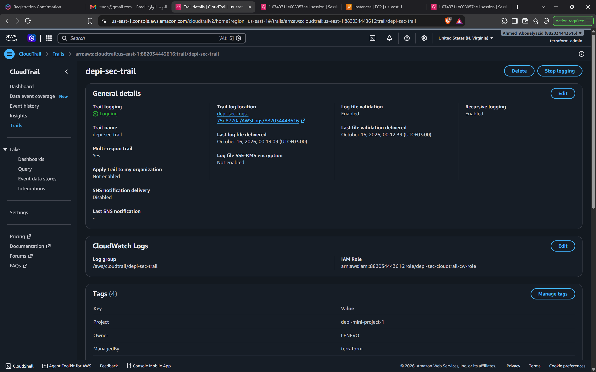
- **CloudTrail Management Event & Identity Record:** Displays recorded management event (`StartLogging`) verifying user identity (`terraform-admin`), IAM user ARN, access key ID, source IP address (`156.217.85.8`), and event details.<br>
  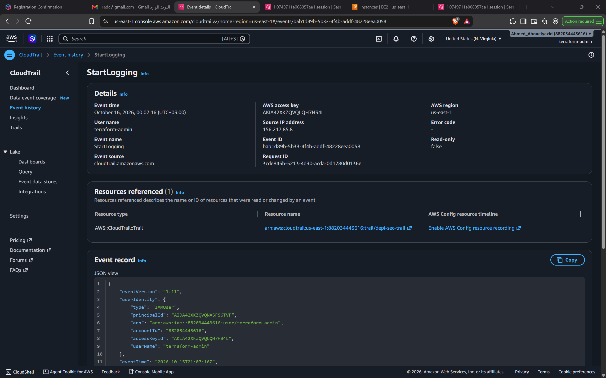

### Task 15 — VPC Flow Logs & Network Traffic Auditing
- **CloudWatch Logs Insights Port 22 REJECT Record:** Demonstrates VPC Flow Logs capturing IP traffic across `depi-sec-app-vpc` to log group `/depi-sec/vpc/flowlogs`. A CloudWatch Logs Insights query explicitly scoped to log group `/depi-sec/vpc/flowlogs` (filtering on `dstport = "22" and action = "REJECT"`) returned four matching records, including an internal TCP port 22 connection attempt from `depi-sec-app-a` (`10.0.11.161`) to `depi-sec-app-b` (`10.0.12.241`) that timed out with exit code 124, verifying Layer 4 network isolation without definitive rule attribution (interactive SSH authentication not tested).<br>
  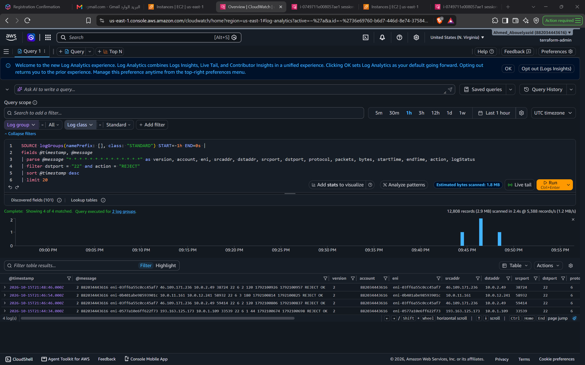

#### Explanation of the 14 Default VPC Flow Log Fields
AWS VPC Flow Logs capture network IP traffic metadata using 14 standard space-delimited fields. The verified REJECT record observed in CloudWatch Logs Insights is:
```text
2 882034443616 eni-0b401abe98593901c 10.0.11.161 10.0.12.241 58932 22 6 3 180 1792100814 1792100825 REJECT OK
```

| Field # | Field Name | Description | Verified Record Value |
| :-: | :--- | :--- | :--- |
| **1** | `version` | The VPC Flow Log version format. Version `2` corresponds to the standard default AWS format. | `2` |
| **2** | `account-id` | The 12-digit AWS account ID of the resource owner. | `882034443616` |
| **3** | `interface-id` | The Elastic Network Interface (ENI) identifier on which the traffic was recorded. | `eni-0b401abe98593901c` |
| **4** | `srcaddr` | The source IPv4 address of the originating network entity. | `10.0.11.161` (`depi-sec-app-a`) |
| **5** | `dstaddr` | The destination IPv4 address targeted by the network connection. | `10.0.12.241` (`depi-sec-app-b`) |
| **6** | `srcport` | The source port number chosen by the sending host. | `58932` |
| **7** | `dstport` | The destination port number targeted by the traffic (e.g., port 22 for SSH). | `22` |
| **8** | `protocol` | The IANA standard protocol number (e.g., `6` for TCP, `17` for UDP, `1` for ICMP). | `6` (TCP) |
| **9** | `packets` | The total number of packets transferred during the capture aggregation window. | `3` |
| **10** | `bytes` | The cumulative count of bytes transferred during the capture aggregation window. | `180` |
| **11** | `start` | The Unix timestamp (in epoch seconds) marking the beginning of the aggregation interval. | `1792100814` |
| **12** | `end` | The Unix timestamp (in epoch seconds) marking the end of the aggregation interval. | `1792100825` |
| **13** | `action` | The security decision applied to the traffic: `ACCEPT` (permitted by both SG and NACL) or `REJECT` (blocked by SG or NACL). | `REJECT` |
| **14** | `log-status` | The operational status of the logging service: `OK` (logged normally), `NODATA` (no traffic during interval), or `SKIPDATA` (records skipped due to internal capacity constraints). | `OK` |

### Task 16 — CloudWatch Alarms & Operations Dashboard
- **Operations Dashboard (`depi-sec-overview`):** Demonstrates the real-time CloudWatch operational dashboard tracking all four key metrics: EC2 CPU utilization across both application servers, ALB unhealthy host count (capturing the test spike to 1 and recovery to 0), RDS MySQL available storage space, and CloudTrail failed console logins.<br>
  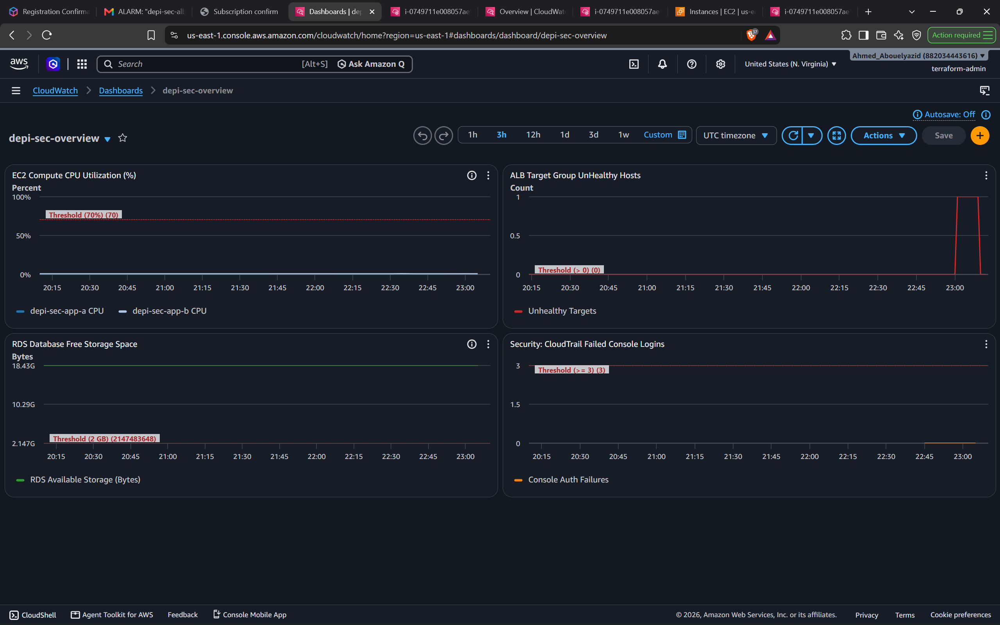
- **ALB Unhealthy Target Alarm Triggered:** Demonstrates CloudWatch Alarm `depi-sec-alb-unhealthy-hosts` entering `In alarm` state when Nginx was stopped on `depi-sec-app-a`, showing active monitoring and evaluation.<br>
  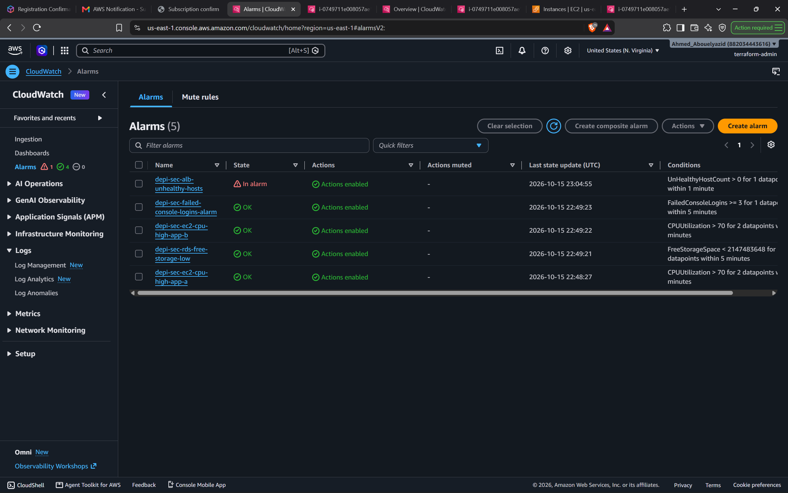
- **Real SNS Alert Email Delivery:** Shows the actual email notification received from Amazon SNS (`depi-sec-alerts`) delivering the alarm payload with state transition (`OK -> ALARM`), affected resource ARNs, and threshold details.<br>
  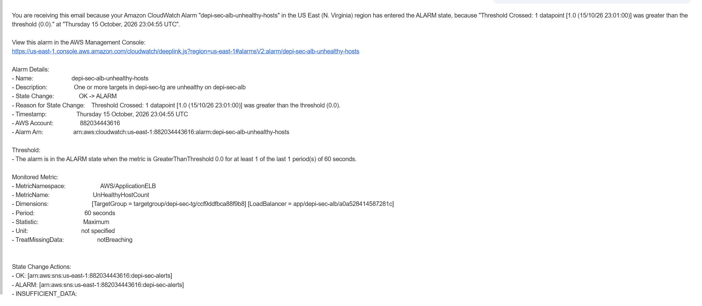

### Task 17 — Event-Driven Security Auto-Remediation (Lambda & EventBridge)
- **Automated Ingress Rule Revocation:** Demonstrates post-remediation verification in the AWS EC2 Management Console for `depi-sec-app-sg` (`sg-045206e75cb53b510`). Following an unauthorized manual authorization of TCP port 22 from `0.0.0.0/0`, the rogue rule was automatically identified and revoked by Lambda, restoring the security group to its hardened baseline where only legitimate HTTP port 80 traffic from `depi-sec-alb-sg` is permitted.<br>
  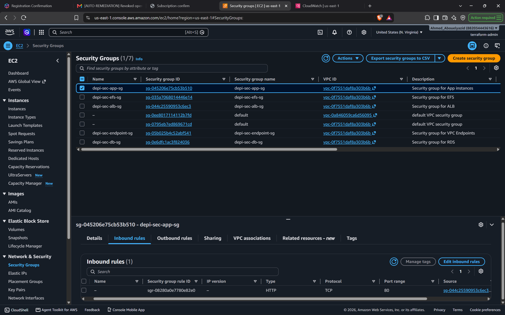
- **Lambda CloudWatch Logs Execution Stream:** Displays CloudWatch Logs stream `/aws/lambda/depi-sec-auto-remediation` capturing the complete automated response: `REMEDIATION_TRIGGERED`, `REMEDIATION_SUCCESS`, the specific security group ID, and `SNS_ALERT_PUBLISHED` confirming rule removal and alert dispatch without leaking sensitive event payloads.<br>
  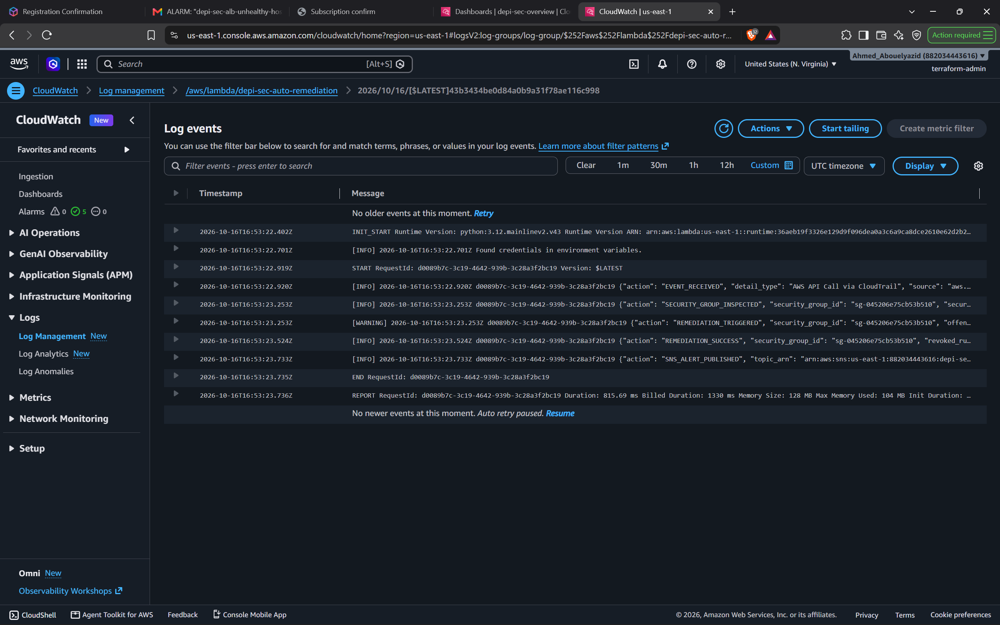
- **Real SNS Auto-Remediation Alert Email:** Displays the actual email notification delivered by Amazon SNS (`depi-sec-alerts`) to the administrator, detailing the incident reason, remediated security group ID (`sg-045206e75cb53b510`), revoked permission payload, UTC timestamp, and remediation engine.<br>
  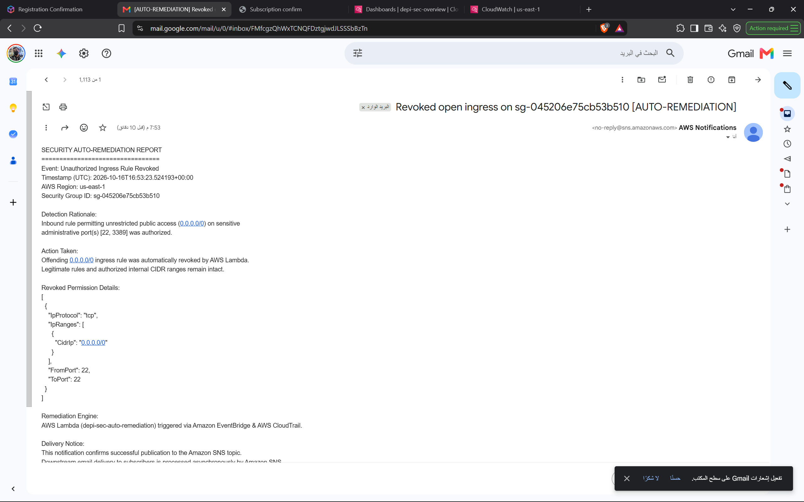

> [!NOTE]
> **Evidence & Testing Boundary Limitation:** The initial "before" screenshot (`17-a-rule-added.png`) was not captured prior to remediation. During live testing, the transient unauthorized port 22 rule was authorized and auto-remediated in real time before a manual browser capture of the insecure state could be obtained. The post-remediation security group state ([`17-b-rule-removed.png`](screenshots/17-lambda/17-b-rule-removed.png)), CloudWatch execution logs ([`17-c-lambda-log.png`](screenshots/17-lambda/17-c-lambda-log.png)), and real SNS email alert ([`17-d-sns-email.png`](screenshots/17-lambda/17-d-sns-email.png)) establish empirical verification of the control. In compliance with testing safety constraints, the dangerous test rule was not re-introduced.

### Task 18 — Isolated Management Network & VPC Peering
- **VPC Peering Connection Status:** Demonstrates active peering connection `depi-sec-app-tools-peering` (`pcx-066a78d3ee36e18f9`) establishing a direct, non-transitive private link between `depi-sec-app-vpc` (`10.0.0.0/16`) and `depi-sec-tools-vpc` (`10.1.0.0/16`).<br>
  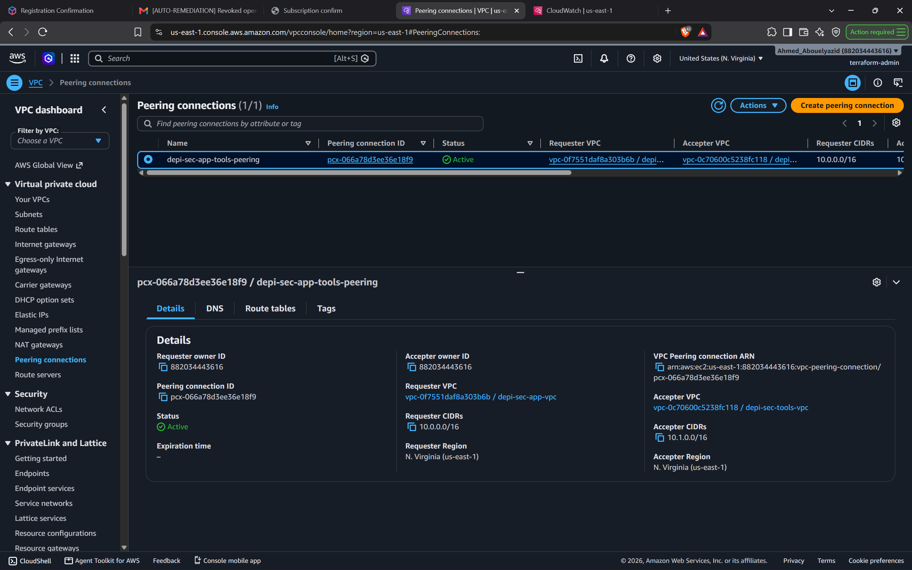
- **App VPC Private Route Table:** Shows route table `depi-sec-private-rt` in the application VPC with active route `10.1.0.0/16` targeting peering connection `pcx-066a78d3ee36e18f9`.<br>
  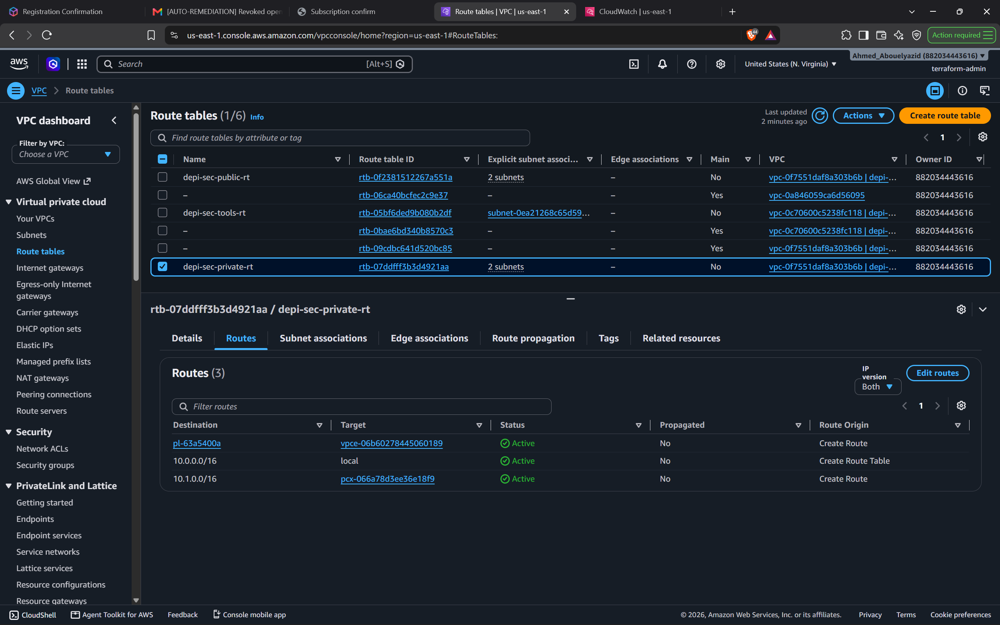
- **Tools VPC Route Table:** Shows route table `depi-sec-tools-rt` in the tools VPC with active route `10.0.0.0/16` targeting peering connection `pcx-066a78d3ee36e18f9`.<br>
  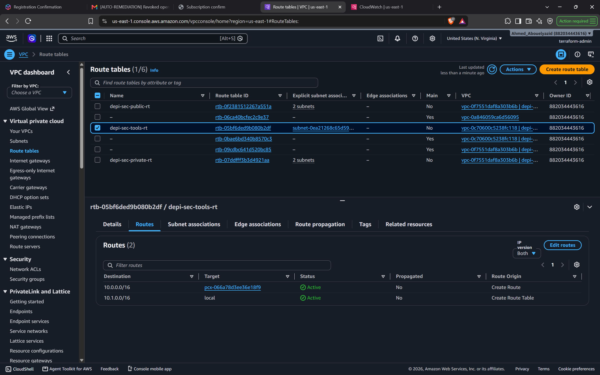
- **Private Peering Connectivity Test (HTTP 200 OK & Ping):** Demonstrates interactive/cloud-init execution from `depi-sec-tools-instance` (`i-039ddfc570cb61341`) in subnet `10.1.1.0/24`, successfully executing ICMP ping (0% packet loss) and HTTP GET to private application server `depi-sec-app-a` (`10.0.11.161`), returning HTTP status 200 OK and rendering the application HTML payload across the private peering link.<br>
  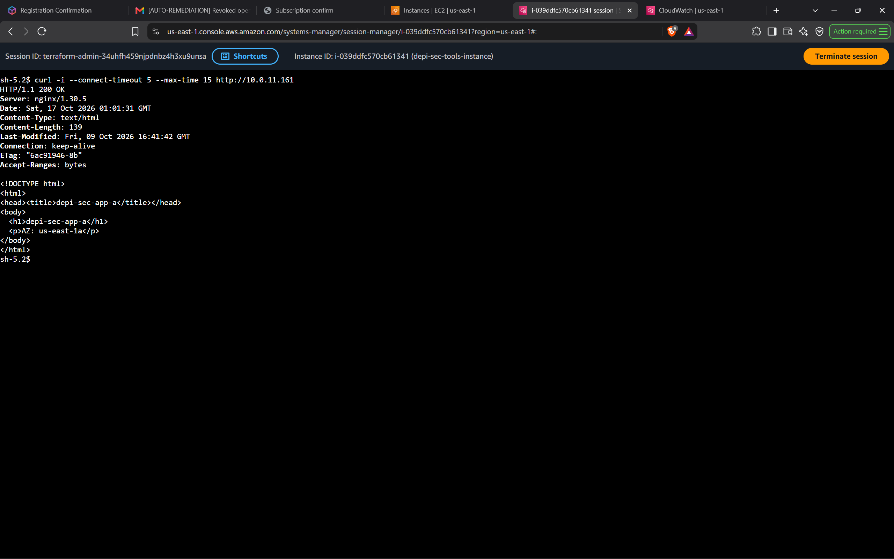

### Task 19 — AWS Backup & Immutable Vault Lock
- **Backup Vault in Governance Lock:** Demonstrates AWS Backup vault `depi-sec-vault` in active `Locked (Governance)` status with minimum retention of 7 days and maximum retention of 365 days, enforcing WORM immutability without permanent compliance lock-in.<br>
  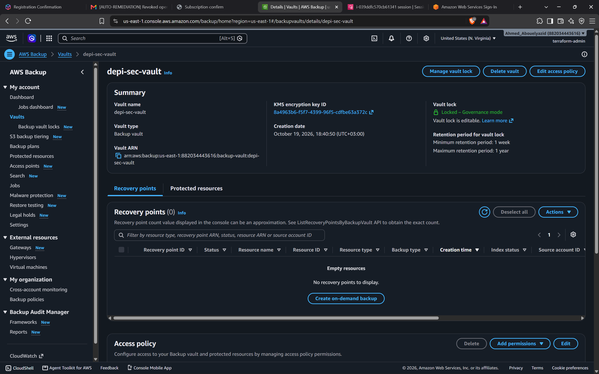
- **On-Demand Backup Job Completed:** Displays completed backup job `07f99bc5-df7c-4124-8aa2-a9560997854f` (100% progress) snapshotting EBS root volume `vol-00fcab943dfdc091c` (`depi-sec-app-a`) with a 7-day retention period ending on 2026-10-26.<br>
  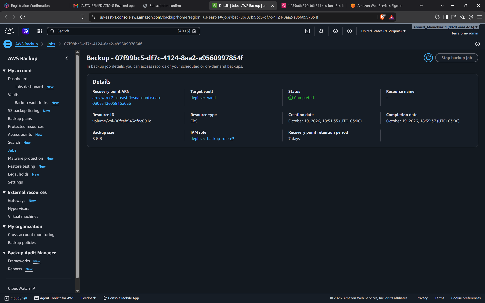
- **Recovery Point Deletion Refused:** Proves Write-Once-Read-Many (WORM) enforcement where an explicit deletion request via AWS CLI executed with administrator credentials is permanently refused by the vault lock with `InvalidRequestException: RecoveryPoint cannot be deleted or updated (Backup vault configured with Lock)`.<br>
  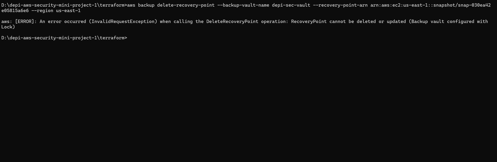

---

## 9. Cost notes

### Resource Cost Breakdown
Building secure cloud platforms requires understanding which services incur hourly or usage-based charges:

| Service / Resource | Pricing Model | Estimated Cost Impact | Optimization Applied |
| :--- | :--- | :--- | :--- |
| **AWS Application Load Balancer** | ~$0.0225/hour + LCU charges | ~$16.20 / month | Single ALB deployed across 2 public subnets |
| **VPC Interface Endpoints (3x)** | ~$0.01/hour per AZ per endpoint | ~$21.60 / month | Scoped strictly to required SSM services (`ssm`, `ssmmessages`, `ec2messages`); shared with Tools VPC over peering |
| **AWS Backup Vault & Vault Lock** | **Free** ($0.00) | $0.00 / month | Vault management and Governance Vault Lock feature incur zero base fees |
| **AWS Backup Storage (Warm EBS)** | $0.05/GB-month | <$0.02 (test usage) | Lightweight on-demand verification of single 8 GB root volume (`vol-00fcab943dfdc091c`) |

| **VPC Gateway Endpoint (S3)** | **Free** ($0.00) | $0.00 | Uses Gateway endpoint to route S3 traffic without NAT costs |
| **NAT Gateways** | ~$0.045/hour + data processing | **$0.00 (Avoided)** | Architected with **Zero NAT Gateways**; all AWS communication utilizes endpoints |
| **Amazon RDS MySQL (db.t3.micro)** | AWS Free Tier eligible (750 hrs) | $0.00 / month | Sized at `db.t3.micro` with single-AZ deployment for educational scope |
| **Amazon EC2 (2x t3.micro App + 1x t3.micro Tools)** | AWS Free Tier eligible (750 hrs) | $0.00 / month | Uses Amazon Linux 2023 `t3.micro` instances |
| **AWS Secrets Manager** | $0.40/secret/month | ~$0.40 / month | Single secret storing database master credentials |
| **AWS CloudFront** | 1 TB free transfer per month | $0.00 / month | `PriceClass_100` (North America and Europe) |
| **Amazon EFS** | 5 GB free storage per month | $0.00 / month | Lightweight access point with TLS encryption |
| **AWS CloudTrail** | Free tier for 1st management copy | ~$0.00 / month | Multi-region trail with S3 read data events scoped to app bucket |
| **Amazon CloudWatch Logs (VPC Flow Logs)** | $0.50/GB ingested + $0.03/GB/mo storage | ~$0.25 / month | Aggregates VPC-level network traffic with 14-day retention |
| **Amazon CloudWatch (Alarms & Dashboard)** | $0.10/alarm/month + free dashboard tier | ~$0.50 / month | 5 standard-resolution alarms with dashboard utilizing free tier allocation |
| **Amazon Simple Notification Service (SNS)** | Free tier for 1st 1,000 email alerts | $0.00 / month | Scoped email subscription for administrator alerts without KMS CMK costs |
| **AWS Lambda (Auto-Remediation)** | 1M free requests + 3.2M sec compute/mo | $0.00 / month | Event-driven Python 3.12 remediation runtime (128 MB RAM, <2s execution) |
| **Amazon EventBridge** | Free tier for AWS service events on default bus | $0.00 / month | Event rule matching CloudTrail `AuthorizeSecurityGroupIngress` |
| **AWS VPC Peering Connection** | **Free** ($0.00) | $0.00 / month | Intra-account, intra-region peering link (`pcx-066a78d3ee36e18f9`) |
| **Inter-VPC Data Transfer** | Free within same AZ (`us-east-1a`) | $0.00 / month | Zero data transfer fee for intra-AZ traffic between Tools A and App A |

### Cost Guardrail Safeguards & Budget Boundaries
- An active monthly budget (`depi-sec-monthly`) of **$10.00 USD** is enforced.
- Automated email alerts fire at **80% actual spend ($8.00)** and **100% forecasted spend ($10.00)**.
- At **90% actual spend ($9.00)**, an automated IAM Budget Action attaches `depi-sec-deny-expensive` to developer groups, immediately blocking any creation of new EC2 or RDS instances.
- **Critical Cost Distinction (Alerts vs Hard Spending Limits):** A $10 budget in AWS is a tracking and alerting tool, not a hard spending cap. AWS Budgets does not shut down or terminate running resources when the threshold is reached. Running EC2 instances, Application Load Balancers, RDS instances, and VPC Interface Endpoints continue to accrue hourly charges regardless of budget alerts until explicitly stopped or destroyed using `terraform destroy`.

---

## 10. How to destroy

To prevent unexpected billing after completing project evaluations, destroy all deployed infrastructure cleanly:

### Step 1: Empty S3 Buckets
Amazon S3 blocks bucket deletion if objects, non-current versions, or delete markers remain. Empty both buckets prior to running Terraform:
```bash
# Retrieve bucket names from Terraform state
APP_BUCKET=$(terraform output -raw app_bucket_name 2>/dev/null || aws s3 ls | grep depi-sec-app | awk '{print $3}')
LOGS_BUCKET=$(terraform output -raw logs_bucket_name 2>/dev/null || aws s3 ls | grep depi-sec-logs | awk '{print $3}')

# Empty all versions and delete markers
aws s3api delete-objects --bucket "$APP_BUCKET" \
  --delete "$(aws s3api list-object-versions --bucket "$APP_BUCKET" --query='{Objects: Versions[].{Key:Key,VersionId:VersionId}}')"
aws s3api delete-objects --bucket "$LOGS_BUCKET" \
  --delete "$(aws s3api list-object-versions --bucket "$LOGS_BUCKET" --query='{Objects: Versions[].{Key:Key,VersionId:VersionId}}')"
```

### Step 2: Run Terraform Destroy
Execute Terraform destroy from the `terraform/` directory:
```bash
terraform destroy
```
Review the proposed destruction plan (confirming removal of CloudFront, ALB, RDS, EC2, VPC Endpoints, and IAM roles) and type `yes`.

### Pre-Destroy Cleanup Dependency for AWS Backup (Task 20 Protocol):
Before executing `terraform destroy`, AWS Backup recovery points and Vault Lock must be addressed in a strict sequence to prevent `ResourceConflictException`:
1. **Halt Future Scheduled Jobs:** Ensure no daily jobs trigger at `05:00 UTC` by completing teardown prior to the window or disabling the plan rule.
2. **Remove Governance Vault Lock (Requires Explicit Approval):** Because `depi-sec-vault` uses Governance Mode (`changeable_for_days` deliberately omitted), an authorized administrator can remove the lock configuration:
   ```bash
   aws backup delete-backup-vault-lock-configuration --backup-vault-name depi-sec-vault
   ```
3. **Delete Test Recovery Points (Requires Explicit Approval):** AWS Backup blocks vault deletion if recovery points remain inside. Delete explicitly identified test recovery points:
   ```bash
   aws backup delete-recovery-point \
     --backup-vault-name depi-sec-vault \
     --recovery-point-arn "arn:aws:ec2:us-east-1::snapshot/snap-030ea42e05815a6e6"
   ```
4. **Execute `terraform destroy`:** With the vault emptied and S3 versions cleared, run `terraform destroy` for a completely clean removal.

### Step 3: Verify Clean Console
Open the AWS Management Console in `us-east-1` and verify that the following dashboards are completely clear:
- **EC2 Console:** 0 running instances, 0 load balancers, 0 target groups.
- **RDS Console:** 0 DB instances.
- **VPC Console:** 0 endpoints, 0 custom VPCs.
- **CloudFront Console:** 0 distributions.
- **AWS Backup Console:** 0 backup vaults, 0 backup plans.

---

## 11. What I learned

1. **Defense-in-depth is significantly more resilient than perimeter security.** Implementing multiple decoupled layers (CloudFront header gating, ALB listener rules, Security Group chaining, stateless NACLs, and OS-level firewalls) ensures that if an attacker bypasses one layer, the system does not fail catastrophically.
2. **Security Group Referencing (SG-as-Source) completely outclasses CIDR-based firewalling.** Referencing security group IDs eliminates hardcoded IP addresses, remains robust during auto-scaling or instance replacement, and guarantees that backend tiers only receive traffic from approved upstream tiers.
3. **Stateless Network ACLs require explicit ephemeral port planning.** Because NACLs are stateless, allowing inbound traffic on port 80/443 without opening outbound ephemeral ports (1024–65535) results in silent connection drops. Understanding TCP handshake mechanics is essential for configuring NACLs correctly.
4. **Bastionless management via AWS Systems Manager Session Manager is vastly superior to SSH.** Eliminating SSH private keys, disabling port 22, and provisioning EC2 instances without public IPs dramatically shrinks the attack surface while generating centralized, non-repudiable audit logs.
5. **Private VPC Endpoints eliminate the necessity of expensive NAT Gateways.** Leveraging Gateway Endpoints for S3 and Interface Endpoints (PrivateLink) for Systems Manager allows compute instances in private subnets to interact with AWS services entirely on private AWS fiber, achieving high security while reducing egress and NAT hourly charges.
6. **Edge termination is not identical to end-to-end encryption.** While browser HTTPS access was verified at CloudFront, forwarding over HTTP to an ALB origin creates a cleartext vulnerability across public transit networks, emphasizing the necessity of custom ACM certificates on backend load balancers in production.
7. **S3 Block Public Access is a critical safety net against human error.** Enforcing all four S3 Block Public Access flags at the account and bucket level prevents accidental public data exposure even if an engineer attempts to apply a public ACL.
8. **Automated cost controls must include proactive policy enforcement.** Relying solely on email alerts during a compromise or accidental deployment is insufficient; configuring automated IAM actions that attach deny policies at budget thresholds prevents creating expensive new resources, though running resources must still be managed.
9. **Terraform lifecycle blocks and dependency ordering are vital for zero-downtime operations.** Utilizing `lifecycle { ignore_changes = [ami] }` prevents unexpected instance replacements when AWS publishes updated base AMIs, and explicit `depends_on` clauses ensure storage mount targets exist before compute instances attempt mounts.
10. **Negative testing is as critical as positive functional testing.** Validating that unauthorized actions fail (e.g., verifying 403 Forbidden on direct ALB access, TCP connection failures on RDS from external networks, and refused public S3 reads) provides empirical proof that security controls are genuinely active without assuming unexecuted application layers.
11. **Comprehensive network visibility requires passive flow auditing at the VPC root boundary.** Provisioning VPC Flow Logs at the VPC level provides unified visibility into every Elastic Network Interface without requiring in-guest agents and operating independently of guest operating system and application workloads. Analyzing the 14 default fields enables engineers to distinguish normal traffic (`ACCEPT`) from scanning activity or unauthorized lateral movement (`REJECT`) across both public and private subnets.
12. **Audit trails require multi-layered log shipping to prevent tampering.** Streaming CloudTrail management and data events simultaneously to encrypted Amazon S3 (for long-term tamper-evident archival with log file validation) and Amazon CloudWatch Logs (for real-time metric filtering and rapid querying via CloudWatch Logs Insights) combines immutability with incident response agility.
13. **Proactive observability and alerting must separate infrastructure metrics from security signals.** While operational alarms (ALB target health, EC2 CPU, RDS storage) track resource availability and performance, security alarms (CloudTrail metric filters for failed console authentication) deliver automated incident awareness. Chaining CloudWatch alarms to Amazon SNS with least-privilege topic policies enables rapid, automated operator notification without introducing fragile third-party dependencies or KMS key overhead.
14. **Event-driven automated remediation dramatically shrinks threat exposure windows.** Traditional security operations rely on scheduled audits or manual triage, leaving unauthorized firewall modifications exposed for hours or days. Chaining CloudTrail API events through Amazon EventBridge to targeted AWS Lambda functions enables near-real-time automated response that revokes unauthorized public CIDRs (`0.0.0.0/0`) within seconds while preserving legitimate internal rules.
15. **VPC Peering provides non-transitive isolation but requires strict bidirectional stateless firewall coordination.** Unlike Transit Gateway which centralizes hub-and-spoke routing, VPC peering establishes direct, point-to-point network links without transitivity (preventing accidental routing loops or lateral perimeter bridging). However, routing packets across VPCs is only half the battle: stateless Network ACLs must explicitly permit forward traffic on sensitive destination ports (80, 443, ICMP) *and* return traffic on client ephemeral ports (1024–65535), reinforcing the principle that Layer 3 route reachability is useless without Layer 4 packet-filter alignment.
16. **Immutable backups (WORM) neutralize ransomware threats but require careful mode selection in educational labs.** Vault Lock prevents malicious actors from deleting snapshots before encrypting primary storage. Deploying in **Governance Mode** (omitting `changeable_for_days`) provides genuine Write-Once-Read-Many protection against standard administrative users while preserving the ability of authorized engineers to unlock and delete recovery points during planned decommissioning. Confirmed via empirical testing that AWS Backup rejects premature deletion with `InvalidRequestException: RecoveryPoint cannot be deleted or updated (Backup vault configured with Lock)`, demonstrating that immutability is enforced directly at the vault storage layer rather than via IAM permission denials.

---

## 12. Known limitations

While the platform implements rigorous security controls for completed Tasks 1–19, several known architectural limitations exist that should be addressed in a production deployment:

1. **Unencrypted HTTP Between CloudFront and Application Load Balancer:**
   - *Limitation:* The CloudFront origin protocol policy is set to `http-only` on port 80 as mandated by the educational project scope.
   - *Risk:* Traffic between AWS CloudFront edge servers and the ALB origin travels over plain HTTP across public network paths.
   - *Production Solution:* Issue a validated public TLS certificate using AWS Certificate Manager (ACM), bind an HTTPS listener on port 443 with TLS 1.3 to the ALB, and configure CloudFront origin protocol policy to `https-only`.
2. **Custom Header Origin Verification is Not a True Network Perimeter:**
   - *Limitation:* The ALB listener rule verifies the `X-Origin-Verify` static secret header, returning HTTP 403 on direct requests.
   - *Risk:* The ALB remains internet-facing with public IP addresses. Direct attacks still initiate TCP/HTTP handshakes that consume load balancer capacity, leaving the ALB exposed to direct Layer 4/7 DoS attacks. Additionally, if the static header leaks, an attacker can bypass CloudFront.
   - *Production Solution:* Attach **AWS CloudFront Managed Prefix Lists** (`aws_ec2_managed_prefix_list`) directly to the ALB security group inbound rules to drop all non-CloudFront traffic at the network packet layer, and deploy **AWS WAF** with rate limiting and automated secret rotation.
3. **Absence of AWS WAF:**
   - *Limitation:* No Web Application Firewall is currently attached to CloudFront or the ALB.
   - *Production Solution:* Deploy AWS WAF with AWS Managed Rules (Common Rule Set, Known Bad Inputs, SQLi/XSS inspection, and IP reputation lists).
4. **Single-AZ RDS Deployment:**
   - *Limitation:* To minimize lab costs, RDS MySQL is deployed as a single instance (`multi_az = false`).
   - *Production Solution:* Enable `multi_az = true` for automated synchronous standby failover across availability zones.
5. **Cost Monitoring vs Hard Spending Limits:**
   - *Limitation:* AWS Budgets provides alerts and automated IAM deny policies for new resources, but AWS does not natively enforce hard billing caps that automatically terminate running infrastructure.
   - *Production Solution:* Deploy automated EventBridge and Lambda functions to shut down or delete test resources if budget thresholds are breached.
6. **CloudTrail Event Delivery Latency in Auto-Remediation:**
   - *Limitation:* EventBridge triggers from CloudTrail management events (`AuthorizeSecurityGroupIngress`). AWS CloudTrail delivers events to EventBridge with an inherent service latency typically between 30 and 60 seconds. Auto-remediation is near-real-time rather than synchronous inline blocking.
   - *Scope Limitation:* The Lambda execution policy and function logic strictly target the application security group (`depi-sec-app-sg`). Non-target security groups in the account are not automatically remediated under this specific function scope.
7. **Outstanding Project Task (Task 20):**
   - Tasks 1–19 are fully deployed, verified, and documented. Only the final clean destroy and billing verification (Task 20) remains pending execution.
