# Cloud Infrastructure Architecture — Secure AWS Web Platform

This document provides a comprehensive technical breakdown of the multi-tier, multi-AZ cloud architecture implemented for DEPI Mini Project 1. It details the network topology, routing architecture, component placement rationale, data flows, and security boundaries across **Tasks 1–18**.

---

## 1. High-Level Architecture Overview

The platform is designed around the core security principles of **Defense in Depth**, **Least Privilege**, and **Zero Trust Network Segmentation**. The system isolates user-facing traffic, compute instances, persistent storage, and relational database services across dedicated tiers and Availability Zones (`us-east-1a` and `us-east-1b`) within an Amazon Virtual Private Cloud (VPC).

### Key Architectural Characteristics
- **Edge Acceleration & HTTPS Ingress:** AWS CloudFront serves as the globally distributed single entry point, configured in Terraform with viewer protocol HTTPS redirection and edge caching.
- **Controlled Ingress via ALB:** An internet-facing Application Load Balancer (ALB) distributed across public subnets receives forwarded requests from CloudFront. Direct internet requests lacking a cryptographically secure `X-Origin-Verify` HTTP header are rejected with an immediate `403 Forbidden` response.
- **Isolated Compute Tier:** EC2 application servers (`depi-sec-app-a` and `depi-sec-app-b`) run in dedicated private subnets with **no public IPv4 addresses**, preventing direct internet accessibility. Management is handled out-of-band via AWS Systems Manager Session Manager.
- **Shared & Encrypted Storage Tier:** Amazon EFS provides a multi-AZ shared file system mounted by both EC2 instances over TLS via an EFS Access Point (`/app-data`, POSIX UID/GID 1000). EC2 root EBS volumes are encrypted using AWS-managed KMS (`gp3`).
- **Private Database Tier:** Amazon RDS MySQL 8.0 operates inside a private DB subnet group spanning both Availability Zones. It is marked `publicly_accessible = false`, has encrypted storage (`gp3`), and accepts inbound traffic exclusively on TCP port 3306 originating from the application security group.
- **Private AWS Service Connectivity:** Private subnets reach Amazon S3 through a VPC Gateway Endpoint and AWS Systems Manager through three VPC Interface Endpoints (`ssm`, `ssmmessages`, `ec2messages`), eliminating the requirement for an internet egress route or NAT gateway for server management and data storage.
- **VPC-Level Network Traffic Auditing:** A VPC Flow Log (`fl-01baa2f74df906054`, status `ACTIVE`, delivery `SUCCESS`) attached to the root of `depi-sec-app-vpc` (`vpc-0f7551daf8a303b6b`) captures IP traffic across all network interfaces (public ALB, private EC2, RDS, EFS, and endpoints) for traffic type `ALL`, publishing to Amazon CloudWatch Logs (`/depi-sec/vpc/flowlogs`) with 14-day retention via dedicated IAM role `depi-sec-vpc-flow-logs-role`.
- **Proactive Platform Observability:** Amazon CloudWatch Metric Alarms, CloudTrail security metric filters, and an operations dashboard (`depi-sec-overview`) monitor infrastructure availability and security anomalies, integrated with Amazon SNS (`depi-sec-alerts`) for real-time alerting.
- **Event-Driven Security Auto-Remediation:** Automated response via Amazon EventBridge and AWS Lambda (`depi-sec-auto-remediation`) listening to CloudTrail management events on `aws.ec2`. If an inbound rule exposes TCP port 22 or 3389 to `0.0.0.0/0` on `depi-sec-app-sg`, Lambda automatically revokes the offending public CIDR while preserving legitimate internal rules, logging structured events to CloudWatch Logs (`/aws/lambda/depi-sec-auto-remediation`) and dispatching an incident notification to Amazon SNS (`depi-sec-alerts`).
- **Administrative Network Isolation & VPC Peering:** An isolated administrative network (`depi-sec-tools-vpc`, `10.1.0.0/16`) hosting an out-of-band monitoring server (`depi-sec-tools-instance`) connected to the application network via a dedicated, non-transitive VPC Peering connection (`pcx-066a78d3ee36e18f9`). Private communication is enforced through discrete security group egress rules and stateless Network ACL rules (`depi-sec-private-nacl`), enabling secure inter-VPC curl and ping diagnostics without public internet traversal.

---

## 2. Architecture Diagram

The following Mermaid diagram visualizes the end-to-end component layout, network boundaries, and communication paths across the platform:

```mermaid
flowchart TB
    subgraph Internet_Zone["Public Internet"]
        User["Client Browser / User"]
        DirectAttacker["Direct Internet Attacker"]
    end

    subgraph AWS_Cloud["AWS Cloud (us-east-1)"]
        subgraph Edge_Tier["Edge Delivery & Governance"]
            CF["AWS CloudFront Distribution\n(depi-sec-cloudfront)\nEnforces HTTPS / Custom Header"]
            Budget["AWS Budgets ($10 USD Alert)\n+ Automated IAM Deny Action"]
            KMS["AWS KMS\n(Default Service Keys)"]
            Secrets["AWS Secrets Manager\n(depi-sec-db-credentials)"]
        end

        subgraph VPC["Application VPC: depi-sec-app-vpc (10.0.0.0/16)"]
            IGW["Internet Gateway\n(depi-sec-igw)"]

            subgraph Public_Tier["Public Subnets Tier (Route Table -> IGW)"]
                subgraph Subnet_Pub_A["Public Subnet A: 10.0.1.0/24 (us-east-1a)"]
                    ALB_Node_A["ALB Ingress Node A"]
                end
                subgraph Subnet_Pub_B["Public Subnet B: 10.0.2.0/24 (us-east-1b)"]
                    ALB_Node_B["ALB Ingress Node B"]
                end
                ALB["Application Load Balancer (depi-sec-alb)\nSecurity Group: depi-sec-alb-sg\nListener Rule: X-Origin-Verify Header Check\nDefault Action: 403 Forbidden"]
            end

            subgraph Private_NACL_Boundary["Network ACL: depi-sec-private-nacl (Stateless Boundary)"]
                subgraph Private_Tier["Private Subnets Tier (No Internet Gateway Route)"]
                    subgraph Subnet_Priv_A["Private Subnet A: 10.0.11.0/24 (us-east-1a)"]
                        EC2_A["EC2 App Instance A\n(depi-sec-app-a)\nAmazon Linux 2023 | t3.micro\nNo Public IP | Encrypted gp3\nNginx Web Server"]
                        EFS_MT_A["EFS Mount Target A"]
                        VPCE_A["Interface Endpoints\n(ssm, ssmmessages, ec2messages)"]
                    end
                    subgraph Subnet_Priv_B["Private Subnet B: 10.0.12.0/24 (us-east-1b)"]
                        EC2_B["EC2 App Instance B\n(depi-sec-app-b)\nAmazon Linux 2023 | t3.micro\nNo Public IP | Encrypted gp3\nNginx Web Server"]
                        EFS_MT_B["EFS Mount Target B"]
                        VPCE_B["Interface Endpoints\n(ssm, ssmmessages, ec2messages)"]
                    end

                    EFS["Amazon EFS File System (depi-sec-efs)\nEncrypted at Rest | Access Point: /app-data (UID 1000)\nMounted at /mnt/shared via TLS"]

                    subgraph DB_Tier["Database Tier (Private DB Subnet Group)"]
                        RDS["Amazon RDS MySQL 8.0 (depi-sec-db)\ndb.t3.micro | 20 GB gp3 | Encrypted\nPublicly Accessible: No"]
                    end
                end
            end

            S3_GW["VPC Gateway Endpoint: S3\n(com.amazonaws.us-east-1.s3)\nAttached to depi-sec-private-rt"]
        end

        subgraph S3_Storage["Private Amazon S3 Buckets (AES-256 / TLS Enforced)"]
            S3_App["Application Data Bucket\n(depi-sec-app-*)\nVersioning + Glacier Lifecycle + PAB"]
            S3_Logs["Centralized Logs Bucket\n(depi-sec-logs-*)\nCloudFront Standard Logging v2 + PAB"]
        end
    end

    %% Flows
    User -->|1. HTTPS Request :443| CF
    DirectAttacker -.->|Direct HTTP Request :80| ALB
    ALB -.->|Match Header Fails -> 403 Forbidden| DirectAttacker

    CF -->|2. Forward HTTP :80 with X-Origin-Verify| ALB
    ALB -->|3. Header Matched -> Forward to Target Group :80| EC2_A
    ALB -->|3. Header Matched -> Forward to Target Group :80| EC2_B

    EC2_A <-->|NFS TCP :2049 via depi-sec-efs-sg| EFS
    EC2_B <-->|NFS TCP :2049 via depi-sec-efs-sg| EFS

    EC2_A -->|MySQL TCP :3306 via depi-sec-db-sg| RDS
    EC2_B -->|MySQL TCP :3306 via depi-sec-db-sg| RDS

    EC2_A -.->|HTTPS :443 via S3 Gateway Endpoint| S3_App
    EC2_B -.->|HTTPS :443 via S3 Gateway Endpoint| S3_App

    EC2_A -.->|HTTPS :443 via Interface Endpoints| VPCE_A
    EC2_B -.->|HTTPS :443 via Interface Endpoints| VPCE_B

    CF -.->|Standard Access Logs v2 via CloudWatch Logs Delivery| S3_Logs
```



---

## 3. Network Design Table

The VPC uses the RFC 1918 CIDR block `10.0.0.0/16`, structured into distinct public and private subnets across two Availability Zones in the `us-east-1` region:

| Subnet Name | Resource Identifier | CIDR Block | Availability Zone | Tier Type | Route Table | Gateway / Route Target |
| :--- | :--- | :--- | :--- | :--- | :--- | :--- |
| **`depi-sec-public-a`** | `aws_subnet.public_a` | `10.0.1.0/24` | `us-east-1a` | Public | `depi-sec-public-rt` | `0.0.0.0/0` -> Internet Gateway (`depi-sec-igw`) |
| **`depi-sec-public-b`** | `aws_subnet.public_b` | `10.0.2.0/24` | `us-east-1b` | Public | `depi-sec-public-rt` | `0.0.0.0/0` -> Internet Gateway (`depi-sec-igw`) |
| **`depi-sec-private-a`** | `aws_subnet.private_a` | `10.0.11.0/24` | `us-east-1a` | Private | `depi-sec-private-rt` | `pl-63a5400a` -> S3 Gateway Endpoint (`vpce-s3`) |
| **`depi-sec-private-b`** | `aws_subnet.private_b` | `10.0.12.0/24` | `us-east-1b` | Private | `depi-sec-private-rt` | `pl-63a5400a` -> S3 Gateway Endpoint (`vpce-s3`) |

### Key Subnet Properties
- `map_public_ip_on_launch = false` is enforced across **all subnets** (public and private). Even within public subnets, resources do not automatically obtain public IPs unless explicitly defined (e.g., the internet-facing ALB elastic network interfaces).
- Private subnets have **no default route (`0.0.0.0/0`)** to an Internet Gateway or NAT Gateway. Inbound and outbound connections to the public internet are completely blocked at the routing layer.

---

## 4. Route Tables & Endpoints

### 4.1. Public Route Table (`depi-sec-public-rt`)
Associated with `depi-sec-public-a` and `depi-sec-public-b`:
- `10.0.0.0/16` -> `local` (VPC internal communication)
- `0.0.0.0/0` -> `aws_internet_gateway.igw` (`depi-sec-igw`)

### 4.2. Private Route Table (`depi-sec-private-rt`)
Associated with `depi-sec-private-a` and `depi-sec-private-b`:
- `10.0.0.0/16` -> `local` (VPC internal communication)
- `pl-63a5400a` (AWS S3 Prefix List) -> `aws_vpc_endpoint.s3_endpoint` (`vpce-s3` Gateway Endpoint)

### 4.3. Private VPC Endpoints
To allow the private EC2 instances to interact with essential AWS services without internet traversal, four VPC endpoints are deployed:

| Endpoint Name | Service Name | Type | Subnets | Security Group | Purpose |
| :--- | :--- | :--- | :--- | :--- | :--- |
| **`depi-sec-s3-endpoint`** | `com.amazonaws.us-east-1.s3` | Gateway | N/A (Route table association) | None (Route Table policy) | Direct, high-bandwidth S3 access from private subnets with no data egress charges |
| **`depi-sec-ssm-endpoint`** | `com.amazonaws.us-east-1.ssm` | Interface (PrivateLink) | `private_a`, `private_b` | `depi-sec-endpoint-sg` | Systems Manager control plane communication |
| **`depi-sec-ssmmessages-endpoint`** | `com.amazonaws.us-east-1.ssmmessages` | Interface (PrivateLink) | `private_a`, `private_b` | `depi-sec-endpoint-sg` | Interactive terminal sessions via Session Manager |
| **`depi-sec-ec2messages-endpoint`** | `com.amazonaws.us-east-1.ec2messages` | Interface (PrivateLink) | `private_a`, `private_b` | `depi-sec-endpoint-sg` | EC2 instance agent message delivery |

The `depi-sec-endpoint-sg` security group strictly permits inbound TCP port 443 from the VPC CIDR `10.0.0.0/16`, ensuring only internal resources can reach the interface endpoints.

---

## 5. Multi-Tier Security Group Chaining

Security groups form the stateful host firewall layer. Rather than allowing broad CIDR ranges, ingress rules utilize **Security Group Referencing (SG-as-Source)** to form a strict chaining model:

```
[ Internet ]
     │
     ▼ (TCP 80: 0.0.0.0/0)
┌─────────────────────────────────┐
│       depi-sec-alb-sg           │
└─────────────────────────────────┘
     │
     ▼ (TCP 80: Source = depi-sec-alb-sg ONLY)
┌─────────────────────────────────┐
│       depi-sec-app-sg           │
└─────────────────────────────────┘
     │                    │
     ▼ (TCP 3306)         ▼ (TCP 2049)
┌──────────────────┐ ┌──────────────────┐
│  depi-sec-db-sg  │ │  depi-sec-efs-sg │
│ (Source=app-sg)  │ │ (Source=app-sg)  │
└──────────────────┘ └──────────────────┘
```

| Security Group | Attached Resource | Direction | Protocol | Port Range | Source / Destination | Rationale |
| :--- | :--- | :--- | :--- | :--- | :--- | :--- |
| **`depi-sec-alb-sg`** | Application Load Balancer | Ingress | TCP | 80 | `0.0.0.0/0` | Accepts public HTTP traffic (filtered by listener rule) |
| | | Egress | ALL | ALL | `0.0.0.0/0` | Forwards health checks & traffic to target instances |
| **`depi-sec-app-sg`** | EC2 Instances (`app_a`, `app_b`) | Ingress | TCP | 80 | `depi-sec-alb-sg` | Accepts HTTP **only** from the ALB; direct IP access rejected |
| | | Egress | ALL | ALL | `0.0.0.0/0` | Communicates with DB, EFS, and VPC endpoints |
| **`depi-sec-db-sg`** | RDS MySQL Instance | Ingress | TCP | 3306 | `depi-sec-app-sg` | Accepts database connections **only** from app instances |
| | | Egress | ALL | ALL | `0.0.0.0/0` | Response traffic |
| **`depi-sec-efs-sg`** | EFS Mount Targets | Ingress | TCP | 2049 | `depi-sec-app-sg` | Accepts NFS mounts **only** from application instances |
| | | Egress | ALL | ALL | `0.0.0.0/0` | Storage response traffic |
| **`depi-sec-endpoint-sg`** | SSM/EC2 Interface Endpoints | Ingress | TCP | 443 | `10.0.0.0/16` | Accepts HTTPS traffic from within the VPC |
| | | Egress | ALL | ALL | `0.0.0.0/0` | Outbound responses |

---

## 6. Stateless Network Access Control Lists (NACLs)

The `depi-sec-private-nacl` is explicitly associated with private subnets (`depi-sec-private-a` and `depi-sec-private-b`). Because NACLs are **stateless**, rules must explicitly permit both inbound and outbound return packets:

| Rule # | Direction | Protocol | Port Range | Source / Destination | Action | Security Rationale |
| :--- | :--- | :--- | :--- | :--- | :--- | :--- |
| **100** | Inbound | TCP | 80 | `10.0.0.0/16` | **ALLOW** | Permits HTTP from the ALB in public subnets |
| **110** | Inbound | TCP | 443 | `10.0.0.0/16` | **ALLOW** | Permits HTTPS responses and internal service traffic |
| **120** | Inbound | TCP | 1024–65535 | `10.0.0.0/16` | **ALLOW** | Permits ephemeral response ports within VPC |
| **130** | Inbound | TCP | 1024–65535 | `0.0.0.0/0` | **ALLOW** | Permits ephemeral return traffic from AWS endpoints |
| **140** | Inbound | TCP | 2049 | `10.0.0.0/16` | **ALLOW** | Permits NFS traffic between EC2 and EFS |
| **200** | Inbound | TCP | 22 | `0.0.0.0/0` | **DENY** | **Explicit block against SSH brute force or scanning** |
| `*` | Inbound | ALL | ALL | `0.0.0.0/0` | **DENY** | Default implicit drop |
| **100** | Outbound | ALL | ALL | `10.0.0.0/16` | **ALLOW** | Unrestricted inter-subnet VPC traffic |
| **110** | Outbound | TCP | 443 | `0.0.0.0/0` | **ALLOW** | Permits outbound HTTPS requests to AWS services |
| `*` | Outbound | ALL | ALL | `0.0.0.0/0` | **DENY** | Default implicit drop |

---

## 7. End-to-End Traffic Paths

### 7.1. External User to Web Application
1. **DNS Resolution & TLS Handshake:** The client queries the CloudFront distribution domain (`d*.cloudfront.net`). CloudFront terminates the TLS connection using the configured default certificate and viewer protocol policy (`redirect-to-https`). Tested evidence confirms browser HTTPS access to the distribution domain.
2. **Custom Header Injection:** CloudFront injects the custom header `X-Origin-Verify: <secret-token>` generated by Terraform (`random_password.origin_verify_header`).
3. **Origin Forwarding:** CloudFront sends the request to the ALB DNS name over HTTP port 80.
4. **ALB Header Verification:**
   - If the request contains the valid `X-Origin-Verify` token, listener rule #1 evaluates to true and forwards traffic to the target group `depi-sec-tg`.
   - If the request lacks or has an invalid header (e.g., direct access to ALB DNS), the default action triggers: immediate HTTP `403 Forbidden` response.
5. **Compute Processing:** The target group routes traffic to the registered EC2 targets (`depi-sec-app-a` and `depi-sec-app-b`) over port 80. Nginx responds with an HTML payload displaying the host's AZ.

### 7.2. Compute to Database
1. The application can query the RDS endpoint `depi-sec-db.<hash>.us-east-1.rds.amazonaws.com` on port 3306.
2. Private DNS resolves the endpoint to an internal private IP (`10.0.11.x` or `10.0.12.x`).
3. `depi-sec-app-sg` permits outbound communication, and `depi-sec-db-sg` permits inbound TCP 3306 specifically from `depi-sec-app-sg`. Internal TCP network reachability to port 3306 was validated from `depi-sec-app-a` using a bash socket probe.

### 7.3. Shared Storage Operations
1. During EC2 initialization (`user_data`), the `amazon-efs-utils` client mounts the EFS file system at `/mnt/shared` via DNS using the Access Point `fsap-*`.
2. Traffic traverses private subnets to the local mount target via port 2049, secured by `depi-sec-efs-sg`. TLS in transit is enforced via the `tls` mount option in `/etc/fstab`.

### 7.4. Administrative Management (Session Manager)
1. An administrator initiates an AWS Systems Manager Session Manager session.
2. The SSM Agent running on the instance maintains an outbound TLS tunnel via PrivateLink interface endpoints (`ssm`, `ssmmessages`, `ec2messages`).
3. Interactive shell sessions are established entirely without public IPs, internet gateways, or inbound port 22 access. Verified that instances have no public IPs and NACL rule 200 denies port 22; direct external SSH execution was not performed.

### 7.5. VPC-Level Network Monitoring & Traffic Telemetry (VPC Flow Logs)
1. **Architectural Scope & Placement:** In accordance with Task 15, `aws_flow_log.app_vpc_flow_log` (Flow Log ID: `fl-01baa2f74df906054`, Status: `ACTIVE`) is attached directly at the root VPC boundary of `depi-sec-app-vpc` (`vpc-0f7551daf8a303b6b`). Establishing monitoring at the VPC level provides universal, continuous coverage across all existing and dynamically provisioned Elastic Network Interfaces (ENIs) without requiring per-subnet or per-instance flow logs:
   - Public Application Load Balancer nodes across AZs (`10.0.1.0/24` and `10.0.2.0/24`).
   - Private EC2 compute instances (`depi-sec-app-a` at `10.0.11.161` and `depi-sec-app-b` at `10.0.12.241`).
   - Private RDS MySQL database instance (`10.0.12.157`).
   - Amazon EFS mount targets across both private subnets.
   - VPC Interface Endpoints (PrivateLink) for Systems Manager and EC2 messaging.
2. **Out-of-Band Hypervisor-Level Telemetry:** VPC Flow Logs collect network traffic metadata out-of-band at the AWS Nitro hypervisor layer, independently of guest operating system and application logging mechanisms:
   - **Independent Metadata Collection:** Because collection operates within the AWS network virtualization layer, connection metadata is captured even if in-guest logging is disabled, misconfigured, or unavailable.
   - **Minimal Host Impact:** Flow logging is decoupled from the virtual machine instances, avoiding CPU, memory, or storage I/O consumption on the guest workloads and avoiding the introduction of inline proxy latency into application data paths.
   - **Decoupled from Guest OS:** Because telemetry generation occurs outside the guest operating system boundary, administrative or compromised users within the virtual machine cannot disable, intercept, or manipulate the flow log stream.
3. **Capture Configuration & Delivery Pipeline:** Configured with `traffic_type = "ALL"`, the flow log records both permitted sessions (`ACCEPT`) and blocked packets (`REJECT`). Flow records are aggregated and published to Amazon CloudWatch Log Group `/depi-sec/vpc/flowlogs` (14-day retention) via least-privilege IAM service role `depi-sec-vpc-flow-logs-role` (`vpc-flow-logs.amazonaws.com`). The delivery status is confirmed as `SUCCESS`.
4. **Standard Telemetry Format (14 Default Fields):** Each record is formatted using the 14 default space-delimited fields: `version`, `account-id`, `interface-id`, `srcaddr`, `dstaddr`, `srcport`, `dstport`, `protocol`, `packets`, `bytes`, `start`, `end`, `action`, and `log-status`.
5. **Empirical Findings & Security Analysis:**
   - Active `ACCEPT` records demonstrate authorized application delivery (ALB to EC2 over TCP port 80), storage communications (EC2 to EFS over TCP port 2049), and Systems Manager management sessions (EC2 to VPC endpoints over TCP port 443).
   - A CloudWatch Logs Insights query explicitly scoped to `/depi-sec/vpc/flowlogs` filtering on `dstport = "22"` and `action = "REJECT"` isolated four distinct dropped connection attempts. These include an internal lateral probe from `depi-sec-app-a` (`10.0.11.161`) to `depi-sec-app-b` (`10.0.12.241`) on destination TCP port 22 that timed out with exit code 124, alongside external reconnaissance hitting public ALB interfaces (`10.0.2.49`, `10.0.1.109`).
   - *Security Enforcement Boundary & Attribution:* This empirical verification confirms Layer 4 TCP network isolation and is distinct from an interactive SSH authentication test, which was not executed. While the Flow Log confirms that unauthorized port 22 traffic is rejected at the network interface layer, flow log records do not differentiate whether the drop was enforced by the stateless Network ACL (`depi-sec-private-nacl` Rule 200) or by the stateful Security Group (`depi-sec-app-sg`), as both firewalls strictly deny inbound port 22.

### 7.6. Platform Observability, Security Alarms & SNS Alerting (Task 16)
1. **Architectural Scope & Placement:** Implemented in `terraform/monitoring.tf`, centralized observability unifies infrastructure telemetry and security event detection into automated alerting workflows and an operations dashboard:
   - **Unified Operational Dashboard (`depi-sec-overview`):** Provides a single-pane-of-glass visual interface containing four dedicated widgets with threshold annotations: (1) EC2 CPU utilization across both application servers, (2) ALB unhealthy target host counts, (3) RDS database free storage space, and (4) CloudTrail failed console login events.
   - **Proactive Metric Alarms:** Five CloudWatch metric alarms continuously evaluate platform health across compute, networking, database, and governance tiers.
2. **Metric Alarm Telemetry & Thresholds:**
   - **EC2 Compute Load Alarms:** Alarms `depi-sec-ec2-cpu-high-app-a` and `depi-sec-ec2-cpu-high-app-b` independently monitor instances `i-0749711e008057ae1` and `i-0306fb121beae9963` for `CPUUtilization > 70%` across two consecutive 5-minute periods (`evaluation_periods = 2`, `datapoints_to_alarm = 2`, `treat_missing_data = "notBreaching"`).
   - **ALB Target Group Health Alarm:** Alarm `depi-sec-alb-unhealthy-hosts` monitors `AWS/ApplicationELB` `UnHealthyHostCount` across dimensions `TargetGroup` (`depi-sec-tg`) and `LoadBalancer` (`depi-sec-alb`). Configured with period `60s` and threshold `> 0`, it triggers immediately if either target fails health checks and emits recovery notifications when the target restores.
   - **RDS Database Capacity Alarm:** Alarm `depi-sec-rds-free-storage-low` monitors `AWS/RDS` `FreeStorageSpace` on `depi-sec-db` for drops below 2 GB (`2,147,483,648` Bytes) over a 300s evaluation window.
   - **Security Failed Console Login Alarm:** Alarm `depi-sec-failed-console-logins-alarm` evaluates security events extracted from CloudTrail, firing if 3 or more authentication failures occur within 5 minutes (`threshold = 3`, `period = 300`, `statistic = "Sum"`).
3. **CloudTrail Security Metric Filtering:**
   - Attached to log group `/aws/cloudtrail/depi-sec-trail`, metric filter `depi-sec-failed-console-logins-filter` inspects incoming JSON audit events using pattern:
     ```text
     { ($.eventName = "ConsoleLogin") && ($.errorMessage = "Failed authentication") }
     ```
   - Matches are mapped to metric `FailedConsoleLogins` in namespace `depi-sec/Security` with value `1` and default `0`, converting unstructured governance logs into actionable metric telemetry.
4. **Decoupled Notification Pipeline & IAM Topic Security:**
   - **SNS Alert Topic (`depi-sec-alerts`):** Aggregates alarm triggers and dispatches email notifications to the confirmed administrator endpoint (`var.alert_email`).
   - **Least-Privilege Topic Access Policy:** Topic policy `depi-sec-alerts-policy` explicitly allows the owning AWS account root (`arn:aws:iam::<account-id>:root`) full topic management rights, while restricting publishing rights strictly to service principal `cloudwatch.amazonaws.com` conditioned on `aws:SourceAccount`. Cross-account and public access are completely prohibited.
   - **Encryption Architecture Decision:** The SNS topic is intentionally configured without AWS-managed KMS encryption. CloudWatch Alarms is incompatible with the default AWS-managed KMS key (`alias/aws/sns`) because its key policy cannot be modified to grant decrypt/generate data key permissions to `cloudwatch.amazonaws.com`. Maintaining an unencrypted topic prevents delivery failure and avoids recurring Customer Managed Key (CMK) monthly charges ($1.00/month).

### 7.7. Event-Driven Security Auto-Remediation Workflow (Task 17)
1. **Event Ingestion & Trigger Pipeline:**
   - When an administrator, service, or rogue actor authorizes an inbound rule (e.g., opening SSH TCP port 22 from `0.0.0.0/0`), AWS CloudTrail captures the AWS management API call `AuthorizeSecurityGroupIngress` from service source `ec2.amazonaws.com`.
   - CloudTrail automatically delivers the management audit event to the Amazon EventBridge default event bus in `us-east-1`.
   - EventBridge rule `depi-sec-remediate-open-ssh` evaluates the event against its pattern:
     ```json
     {
       "source": ["aws.ec2"],
       "detail-type": ["AWS API Call via CloudTrail"],
       "detail": {
         "eventSource": ["ec2.amazonaws.com"],
         "eventName": ["AuthorizeSecurityGroupIngress"]
       }
     }
     ```
   - Matches trigger target `AutoRemediateOpenSSH`, invoking AWS Lambda function `depi-sec-auto-remediation` via resource-based invoke permission `AllowExecutionFromEventBridge`.
2. **Defensive Validation & Scope Control:**
   - The Python 3.12 function validates the EventBridge envelope (`source`, `detail-type`, `eventSource`, `eventName`).
   - Failed API calls (containing `errorCode` or `errorMessage`) are safely ignored, as no actual security group changes occurred.
   - Extracts and validates the security group ID using regex `^sg-[0-9a-fA-F]{8,17}$`.
   - Evaluates the group ID against `TARGET_SECURITY_GROUP_ID` (`depi-sec-app-sg`). Non-target security groups are safely bypassed with a structured log to prevent out-of-scope modifications.
3. **Discrete CIDR Revocation vs Rule Destruction:**
   - Queries current permissions via `ec2:DescribeSecurityGroups`.
   - Scans `IpPermissions` for IPv4 public exposure (`0.0.0.0/0`) on sensitive administrative ports: TCP 22 (SSH), TCP 3389 (RDP), overlapping port ranges (e.g., 20–25, 3000–4000), or all-traffic protocol `-1`.
   - Constructs a discrete revocation payload containing **only** `IpRanges: [{"CidrIp": "0.0.0.0/0"}]` for the offending port range.
   - Preserves legitimate CIDRs (e.g., `10.0.0.0/16`), security group references (ALB SG on port 80), and prefix lists within the same rule set.
4. **Race Condition & Duplicate Event Protection:**
   - If `ec2:RevokeSecurityGroupIngress` encounters `InvalidPermission.NotFound` (due to duplicate EventBridge event delivery or concurrent execution), the function re-describes the security group's active rules.
   - If no dangerous rules remain, it verifies the group is clean (`ALREADY_CLEAN`) and suppresses redundant SNS notifications.
   - If dangerous rules remain, it reports incomplete remediation (`FAILED_DANGEROUS_RULES_REMAIN`) rather than falsely claiming success.
5. **Decoupled Incident Alerting:**
   - Upon successful revocation, the function formats an operational incident report containing the security group ID, UTC timestamp, AWS region, revoked rule payload, and detection rationale.
   - Dispatches the payload via `sns:Publish` to topic `depi-sec-alerts`, which asynchronously delivers the email notification to the subscribed security administrator.
6. **Latency & Scope Boundaries:**
   - *CloudTrail Latency:* Management events typically reach EventBridge within 30 to 60 seconds of API execution. The auto-remediation workflow operates near-real-time rather than as an inline blocking control.
   - *Security Group Scope:* Least-privilege IAM permissions and function logic constrain remediation authority strictly to the designated application security group (`depi-sec-app-sg`).

### 7.8. Isolated Management Network & VPC Peering Architecture (Task 18)
1. **Management Plane Isolation & Topology:**
   - In accordance with enterprise zero-trust networking, administrative and monitoring tooling is physically isolated into a separate Virtual Private Cloud (`depi-sec-tools-vpc`, CIDR `10.1.0.0/16`).
   - The tools network provisions a dedicated private subnet (`depi-sec-tools-a`, CIDR `10.1.1.0/24`) in Availability Zone `us-east-1a` with `map_public_ip_on_launch = false`. The subnet contains no Internet Gateway and no public IP addresses.
2. **Point-to-Point VPC Peering Architecture:**
   - An intra-account, intra-region peering link (`pcx-066a78d3ee36e18f9`, `depi-sec-app-tools-peering`) connects `depi-sec-app-vpc` (`10.0.0.0/16`) directly to `depi-sec-tools-vpc` (`10.1.0.0/16`).
   - The connection operates with `auto_accept = true` within the single owning AWS account (`882034443616`).
   - **Non-Transitive Routing Security Boundary:** As highlighted in project specifications, VPC peering is non-transitive. Traffic cannot transit through `tools_vpc` to reach external networks, nor can external networks access `app_vpc` through `tools_vpc`.
3. **Bidirectional Route Synchronization:**
   - **App VPC Private Route Table (`depi-sec-private-rt`):** Routes destination CIDR `10.1.0.0/16` targeting peering connection `pcx-066a78d3ee36e18f9`.
   - **Tools VPC Route Table (`depi-sec-tools-rt`):** Routes destination CIDR `10.0.0.0/16` targeting peering connection `pcx-066a78d3ee36e18f9`.
4. **Least-Privilege Security Group Egress Controls:**
   - Compute instance `depi-sec-tools-instance` (`i-039d5. **Bidirectional Stateless Network ACL Enforcement (`depi-sec-private-nacl`):**
   - Because `depi-sec-private-nacl` is stateless, least-privilege rules accommodate peering traffic explicitly:
     - **Inbound Rules:** Rule 150 (TCP 80 from `10.1.1.0/24`), Rule 151 (ICMP from `10.1.1.0/24`), Rule 152 (TCP 443 from `10.1.1.0/24`).
     - **Outbound Rules:** Rule 150 (TCP 1024–65535 to `10.1.1.0/24` for ephemeral socket replies), Rule 151 (ICMP to `10.1.1.0/24` for Echo Reply).
6. **Zero-Cost SSM Endpoint Sharing via Dynamic Resolution:**
   - Rather than provisioning three additional interface endpoints in `tools_vpc` (which would accrue ~$21.60/month in hourly endpoint fees), `depi-sec-tools-instance` reuses the existing PrivateLink endpoints in `app_vpc` across the peering connection.
   - At launch, `user_data` dynamically resolves the private IP addresses of the SSM endpoints via their official AWS VPCE DNS names (`aws_vpc_endpoint.*.dns_entry[0].dns_name`), maps them to canonical hostnames (`ssm.us-east-1.amazonaws.com`, `ssmmessages`, `ec2messages`) in `/etc/hosts`, and restarts the SSM agent.
   - Because canonical hostnames match the endpoint's public TLS certificate SAN, secure TLS validation succeeds natively without recurring endpoint charges.

### 7.9. Immutable Backup Architecture & Governance Vault Lock (Task 19)
1. **Architectural Scope & Placement:**
   - In accordance with Task 19, centralized backup automation and ransomware immutability are established via AWS Backup in `us-east-1`.
   - The backup architecture consists of integrated components defined in `terraform/backup.tf`:
     - **Backup Vault (`depi-sec-vault`):** A centralized encrypted storage container for recovery points using default AWS-managed KMS encryption (`aws/backup`).
     - **Backup Vault Lock Configuration:** Enforces Write-Once-Read-Many (WORM) storage immutability in **Governance Mode** with `min_retention_days = 7` and `max_retention_days = 365`. The `changeable_for_days` parameter is deliberately omitted to prevent accidental, unremovable Compliance Mode locking in an educational environment.
     - **Backup Plan (`depi-sec-backup-plan`):** Defines automated scheduled backups via rule `depi-sec-daily-backup-rule` running daily at `05:00 UTC` (`cron(0 5 * * ? *)`) with `delete_after = 30` (30-day retention), a 60-minute start window, and a 120-minute completion window.
     - **Backup Selection (`depi-sec-backup-selection`):** Evaluates tagged resources across all opted-in service types in `us-east-1` matching `Project = "depi-mini-project-1"`.
2. **IAM Delegation & Least Privilege:**
   - AWS Backup assumes service role `depi-sec-backup-role` (`backup.amazonaws.com`).
   - The role attaches two AWS managed policies:
     - `arn:aws:iam::aws:policy/service-role/AWSBackupServiceRolePolicyForBackup`: Grants permissions to describe, snapshot, and tag protected EC2, EBS, RDS, and EFS resources.
     - `arn:aws:iam::aws:policy/service-role/AWSBackupServiceRolePolicyForRestores`: Grants permissions required to execute data recovery workflows.
3. **Governance Mode Safety & WORM Enforcement:**
   - While the Vault Lock is active, any attempt to delete recovery points before their retention expires (even by administrative identities) is intercepted and rejected by AWS Backup with `InvalidRequestException: RecoveryPoint cannot be deleted or updated (Backup vault configured with Lock)`.
   - Because Governance Mode is enforced, an authorized administrator retains the ability to remove the vault lock via `backup:DeleteBackupVaultLockConfiguration`, ensuring clean teardown during project decommissioning (Task 20) without permanent lock-in.

---

## 8. Architectural Limitations & Security Boundary Analysis

As required by the project specifications, the architecture incorporates educational project design decisions that introduce important security limitations. These must be understood and addressed in production:

### 8.1. Plain HTTP In Transit Between CloudFront and ALB
- **Configuration:** CloudFront's `custom_origin_config` is set to `origin_protocol_policy = "http-only"` using port 80.
- **Vulnerability:** Traffic traversing the public internet between AWS edge locations and the ALB is transmitted in cleartext. Any intermediary entity with wiretapping or inspection capability on public transit links could inspect or tamper with requests.
- **Production Remediation:** Request a custom public certificate using AWS Certificate Manager (ACM) validated via Route 53 DNS, attach an HTTPS listener (port 443) with TLS 1.3 to the ALB, and configure CloudFront origin protocol policy to `https-only`.

### 8.2. Custom Header (`X-Origin-Verify`) Limitations
- **Configuration:** CloudFront adds `X-Origin-Verify`, and the ALB listener rule verifies the static string.
- **Vulnerability:**
  1. **Not a Network Perimeter:** The ALB remains internet-facing with publicly resolvable DNS and public IP addresses. While direct requests receive a `403 Forbidden`, the ALB still consumes resources processing incoming TCP and HTTP handshakes, leaving it open to direct Layer 4 and Layer 7 volumetric Denial of Service (DDoS) attacks that bypass CloudFront's AWS Shield standard protections.
  2. **Static Secret Risk:** If the 32-character secret is leaked via application error traces, debug logs, or access logging, an attacker can supply the header and reach the origin directly.
- **Production Remediation:**
  - Associate **AWS WAF** with both CloudFront and the ALB.
  - Utilize **CloudFront Managed Prefix Lists** (`aws_ec2_managed_prefix_list`) in the ALB security group ingress rules, allowing port 80/443 traffic **only** from CloudFront origin IPs and dropping all other internet traffic at the network level.
  - Implement secret rotation via AWS Secrets Manager and Lambda.

---

## 9. Component Placement Rationale

| Component | Placement | Rationale |
| :--- | :--- | :--- |
| **CloudFront** | Global AWS Edge Locations | Low-latency caching, global DDoS mitigation, and single public entry point enforcing HTTPS redirection. |
| **ALB** | Public Subnets (`10.0.1.0/24`, `10.0.2.0/24`) | Application Load Balancers requiring internet ingress must be located in public subnets with Internet Gateway routing to accept external CloudFront traffic. |
| **EC2 App Servers** | Private Subnets (`10.0.11.0/24`, `10.0.12.0/24`) | Eliminates external attack vectors; instances do not need public internet access to serve traffic forwarded by the ALB or to be managed via SSM. |
| **EFS Mount Targets** | Private Subnets (Multi-AZ) | Colocates NFS targets in the same subnets as the EC2 instances to minimize latency and ensure NFS traffic never leaves the private subnet boundary. |
| **RDS MySQL** | Private Subnets (DB Subnet Group) | Database engines must never reside in public subnets. Restricting access to internal application security groups eliminates direct internet brute force or exploit exposure. |
| **VPC Endpoints** | Private Subnets / Route Tables | Keeps management (SSM) and object storage (S3) traffic entirely on AWS private infrastructure, saving NAT Gateway data processing costs and eliminating public egress routes. |
| **VPC Flow Logs** | VPC Root (`vpc-0f7551daf8a303b6b`) | Out-of-band, hypervisor-level monitoring across all ENIs in all subnets, capturing network traffic metadata into CloudWatch Logs independently of guest instances without consuming host instance compute resources. |
| **CloudWatch Alarms & Dashboard** | Regional (`us-east-1`) | Aggregates operational and security telemetry across EC2, ALB, RDS, and CloudTrail log streams, providing proactive incident notification and consolidated visual dashboard monitoring. |
| **SNS Alert Topic (`depi-sec-alerts`)** | Regional (`us-east-1`) | Decoupled serverless notification service delivering real-time administrator alerts for infrastructure failures and security anomalies with strict least-privilege IAM policies. |
| **Auto-Remediation Lambda (`depi-sec-auto-remediation`)** | Regional Serverless (`us-east-1`) | Event-driven Python 3.12 runtime with least-privilege IAM role executing near-real-time revocation of unauthorized public ingress rules without hosting infrastructure overhead. |
| **EventBridge Rule (`depi-sec-remediate-open-ssh`)** | Regional Default Bus (`us-east-1`) | Decoupled event routing evaluating CloudTrail EC2 API calls and triggering remediation Lambda with minimal overhead. |
| **Tools VPC (`depi-sec-tools-vpc`)** | Regional (`10.1.0.0/16`) | Provides network boundary isolation for administrative operations and monitoring, preventing co-mingling of operational tools with the production application VPC. |
| **Tools Subnet (`depi-sec-tools-a`)** | Private (`10.1.1.0/24`, `us-east-1a`) | Hosts the monitoring instance without public IP assignment or internet gateway routes, enforcing zero-trust isolation. |
| **VPC Peering (`pcx-066a78d3ee36e18f9`)** | Intra-Region (`us-east-1`) | Direct point-to-point private network link between Tools VPC and App VPC over private AWS fiber with zero data transfer fees within the same AZ (`us-east-1a`). |
| **Tools Monitoring Instance (`depi-sec-tools-instance`)** | Private Subnet (`10.1.1.0/24`) | Out-of-band `t3.micro` monitoring instance (`i-039ddfc570cb61341`) managed via SSM, executing automated and interactive diagnostic verification of application health. |
| **AWS Backup Vault (`depi-sec-vault`)** | Regional (`us-east-1`) | Encrypted, WORM-protected backup vault enforcing Governance Mode immutability (7–365 day retention) against ransomware and accidental deletion. |
| **AWS Backup Plan (`depi-sec-backup-plan`)** | Regional (`us-east-1`) | Orchestrates automated daily backups at 05:00 UTC with 30-day lifecycle retention targeting resources tagged `Project = depi-mini-project-1`. |
| **AWS Backup IAM Role (`depi-sec-backup-role`)** | Global / IAM | Least-privilege service role assumed by `backup.amazonaws.com` with managed backup and restore execution policies. |
